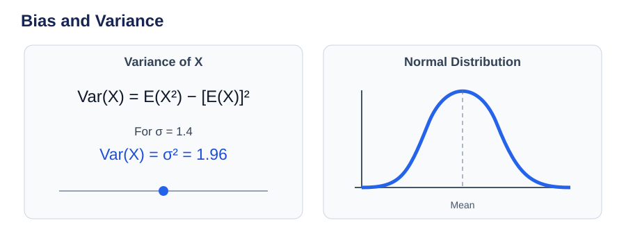
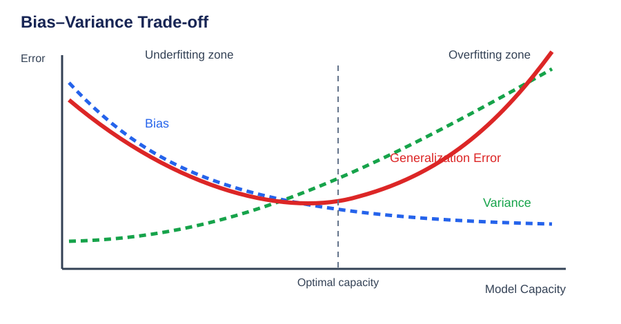
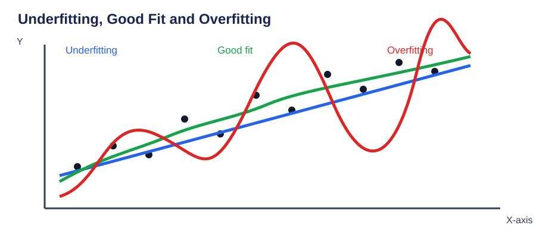
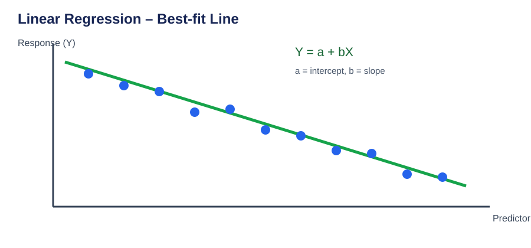
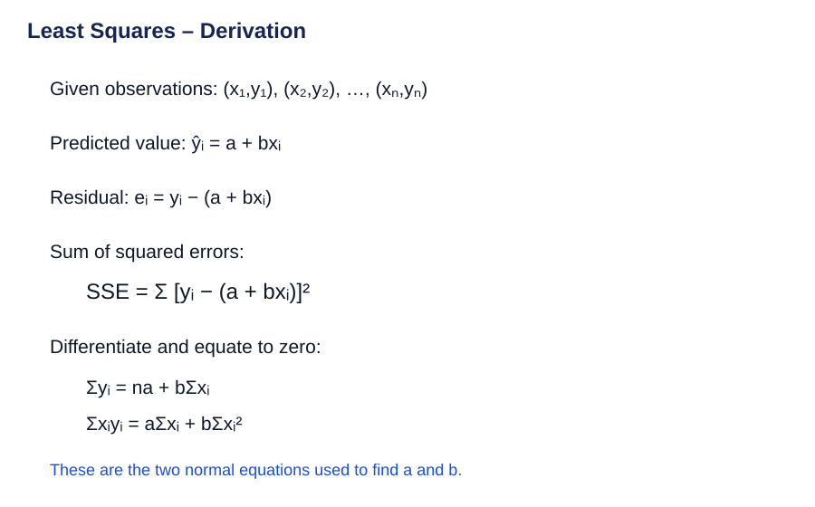
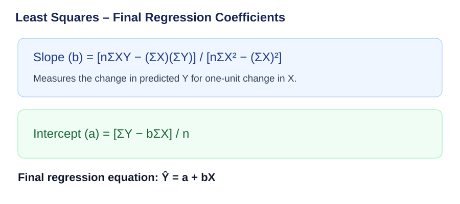
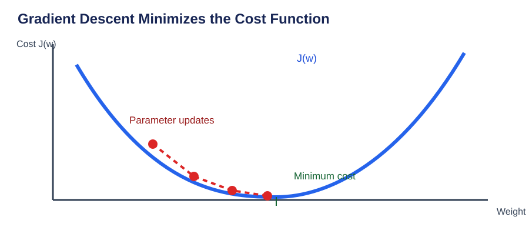

# Machine Learning – Supervised Learning: Regression

> Source: ENDSEM ML.docx supplied by the user. Answer text is transferred from the source in its original question order. Text and tables are retained where extractable. The key visual explanations from the source are restored as SVG diagrams in the Images folder; these are clean, readable redrawings of the source visuals.

Q. Explain Bias, Variance and the Bias-Variance Trade-off with suitable examples. (4–6 Marks)

1. Introduction

In Machine Learning, Bias and Variance are two major sources of prediction errors. They help us understand how
well a model learns patterns from training data and performs on unseen data.

2. Bias

Bias is the error caused by making overly simple assumptions about the data. A high-bias model cannot capture the
actual relationship between input and output.

         It leads to underfitting.

         The model performs poorly on both training and testing data.

         Example: Using a straight-line model to predict data that follows a complex curved pattern.

3. Variance

Variance refers to how much a model's predictions change when trained on different training datasets.

         High variance leads to overfitting.

         The model learns training data too closely, including noise.

         It performs well on training data but poorly on unseen testing data.

         Example: A very deep decision tree that memorizes training examples but fails to predict new examples
          accurately.

4. Bias-Variance Trade-off

The Bias-Variance Trade-off is the balance between bias and variance to achieve good model performance and better
generalization.

         If bias is high, the model becomes too simple and underfits.

         If variance is high, the model becomes too complex and overfits.

         A good model maintains a balance between bias and variance, reducing overall prediction error.

5. Diagram

6. Example

Consider predicting house prices based on area:

       High Bias: A simple model assumes that every house price increases at the same fixed rate with area. It may
        fail to capture other important patterns.

       High Variance: A highly complex model memorizes the prices of houses in the training dataset but gives
        inaccurate predictions for new houses.

       Balanced Model: A properly trained model learns the important patterns without memorizing the training
        data and predicts prices more accurately.

7. Conclusion

The objective of Machine Learning is to maintain an appropriate balance between bias and variance so that the
model avoids underfitting and overfitting and performs well on unseen data.

Q. Explain Underfitting and Overfitting. Differentiate between them and describe techniques to reduce both. (6
Marks)

1. Introduction

In Machine Learning, Underfitting and Overfitting are two common problems that affect the performance of a model.
They occur when a model fails to learn the actual patterns in the training data or learns them too closely.

2. Underfitting

Underfitting occurs when a machine learning model is too simple to learn the underlying patterns and relationships
in the training data.

Characteristics:

       The model has high bias and low variance.

       It performs poorly on both training and testing data.

       It fails to capture important patterns.

       It usually occurs when the model is too simple or insufficiently trained.

Example: Using a straight-line model to predict data that follows a complex curved pattern.

Techniques to Reduce Underfitting:

    1. Increase model complexity by using a more suitable algorithm.

    2. Add relevant features to the training dataset.

    3. Reduce excessive regularization.

    4. Train the model for more epochs, if insufficient training is the cause.

    5. Use better feature selection and engineering.

3. Overfitting

Overfitting occurs when a machine learning model learns the training data too closely, including noise and
unnecessary details. As a result, it fails to generalize well to unseen data.

Characteristics:

       The model has low bias and high variance.

       It performs very well on training data but poorly on testing data.

       It memorizes training examples instead of learning general patterns.

       It usually occurs when the model is too complex or trained excessively.

Example: A very deep decision tree memorizes the training examples but makes inaccurate predictions for new data.

Techniques to Reduce Overfitting:

    1. Regularization: Use L1 or L2 regularization to penalize excessive model complexity.

    2. Cross-validation: Use K-fold cross-validation to evaluate model performance on different data subsets.

    3. Pruning: Remove unnecessary branches from a decision tree.

    4. Dropout: Randomly deactivate some neurons during neural network training.

    5. Early Stopping: Stop training when validation performance starts getting worse.

    6. Data Augmentation: Increase training data by creating modified versions of existing samples.

4. Difference Between Underfitting and Overfitting

Underfitting                                            Overfitting

Model is too simple.                                    Model is too complex.

Fails to learn important patterns.                      Learns training data too closely, including noise.

Has high bias and low variance.                         Has low bias and high variance.

Poor performance on training data.                      Very good performance on training data.

Poor performance on testing data.                       Poor performance on testing data.

Usually caused by insufficient model complexity or      Usually caused by excessive model complexity or insufficient
training.                                               training data.

Reduced by increasing model complexity and              Reduced by regularization, pruning, dropout and more
improving features.                                     training data.

5. Diagram

6. Conclusion

Underfitting and Overfitting reduce the accuracy and generalization ability of a machine learning model. The
objective is to develop a balanced model that learns important patterns without being too simple or too complex.

Q. Explain Training Error and Generalization Error in Machine Learning. (6 Marks)

1. Introduction

In Machine Learning, Training Error and Generalization Error are two important measures used to evaluate the
performance of a model. They help determine how well a model learns from training data and predicts unseen data.

2. Training Error

Training Error is the difference between the actual output and the predicted output for the data used to train the
machine learning model.

       It measures how well the model fits the training dataset.

       It is calculated using a loss or error function.

       Lower training error indicates that the model fits the training data better.

       Very low training error does not always mean that the model will perform well on new data.

Example: A model is trained using 100 house records. If it makes incorrect predictions for 5 records, its classification
training error is 5%.

3. Generalization Error

Generalization Error is the error made by a trained model when predicting outcomes for new, unseen data.

       It measures the ability of a model to generalize beyond the training dataset.

       It is evaluated using a separate testing dataset.

       Lower generalization error indicates better prediction performance on unseen data.

       High generalization error may indicate overfitting.

Example: If the same model is tested on 100 new house records and makes incorrect predictions for 20 records, its
testing error is 20%.

4. Difference Between Training Error and Generalization Error

Training Error                                     Generalization Error

Error calculated on training data.                 Error calculated on unseen data.

Measures how well the model fits training data. Measures how well the model performs on new data.

Calculated during model training.                  Estimated using validation or testing data.

Lower value indicates a better fit to training data. Lower value indicates better generalization.

Very low error may occur due to memorization.      High error may indicate overfitting.

Depends on the training dataset.                   Depends on how well the learned patterns apply to unseen data.

5. Relationship Between Training and Generalization Error

       Low Training Error + Low Generalization Error: The model learns patterns correctly and performs well on
        new data.

       Low Training Error + High Generalization Error: The model suffers from overfitting.

       High Training Error + High Generalization Error: The model may suffer from underfitting.

6. Conclusion

Training Error measures the model's performance on known training data, whereas Generalization Error measures its
performance on unseen data. A good machine learning model should maintain low values for both errors to achieve
better prediction accuracy.

Q. What is Regression? Explain different Regression Models and Linear Regression with a suitable example. (6–9
Marks)

1. Introduction

Regression is a supervised machine learning technique used to predict a continuous numerical value based on one or
more input variables.

It establishes a relationship between dependent and independent variables to estimate unknown values.

Examples:

       Predicting house prices based on area.

       Predicting salary based on experience.

       Predicting stock prices based on market data.

2. Different Regression Models

The commonly used regression models are:

Regression Model          Explanation

1. Simple Linear          Establishes a linear relationship between one independent variable and one dependent
Regression                variable.

2. Multiple Linear
                          Predicts the dependent variable using two or more independent variables.
Regression

3. Polynomial
                           Models a non-linear relationship by using polynomial terms of the independent variable.
Regression

4. Ridge Regression        Uses L2 regularization to reduce overfitting by penalizing large coefficient values.

5. Lasso Regression        Uses L1 regularization and can make some coefficients zero, helping in feature selection.

                           Predicts the probability of a categorical outcome, generally used for classification rather
6. Logistic Regression
                           than continuous-value regression.

3. Linear Regression

Linear Regression is a supervised learning algorithm that establishes a straight-line relationship between
independent and dependent variables. It is used to predict continuous numerical values.

Types of Linear Regression:

    1. Simple Linear Regression: Uses one independent variable to predict one dependent variable.

    2. Multiple Linear Regression: Uses two or more independent variables to predict one dependent variable.

Mathematical Representation:

The equation of a simple linear regression model is:

Where:

        ŷ = Predicted output

        x = Independent variable

        b₀ = Intercept (value of y when x is zero)

        b₁ = Slope or regression coefficient

Working of Linear Regression:

    1. Collect the training dataset containing input and output values.

    2. Identify independent and dependent variables.

    3. Fit a straight line that represents the relationship between the variables.

    4. Calculate the prediction errors (residuals).

    5. Find the best-fit line by minimizing the sum of squared residuals using the least squares method.

    6. Use the fitted model to predict values for new inputs.

4. Suitable Example

Consider predicting the salary of an employee based on years of experience.

Experience (Years) Salary (₹ in thousands)

1                   20

2                   30

3                   40

4                   50

5                   60

From the given data, salary increases by ₹10,000 for every additional year of experience.

For an employee having 6 years of experience:

Predicted Salary = ₹70,000

Thus, Linear Regression helps predict the salary based on the relationship between experience and salary.

5. Advantages of Linear Regression

    1. Simple and easy to understand and implement.

    2. Requires less computational power.

    3. Helps identify relationships between variables.

    4. Useful for predicting continuous numerical values.

    5. The model is easy to interpret.

6. Applications

       House price prediction.

       Sales and revenue forecasting.

       Salary prediction.

       Stock market price estimation.

       Demand forecasting.

7. Conclusion

Regression is an important supervised learning technique used for predicting continuous values. Linear Regression is
one of its simplest models, which finds the best-fit line between input and output variables to make predictions.

Q. Explain the Least Square Method in Linear Regression. Derive the regression equation using the least square
approach. (6 Marks)

1. Introduction

The Least Square Method is a mathematical technique used in Linear Regression to find the best-fit straight line for a
given set of data points.

It minimizes the sum of the squares of the differences between actual values and predicted values. These differences
are called residuals or errors.

2. Regression Equation

The equation of a simple linear regression line is:

Where:

        y = Predicted dependent variable.

        x = Independent variable.

        a = Intercept.

        b = Slope of the regression line.

3. Derivation Using Least Square Method

To find the best-fit line, we minimize SSE with respect to a and b.

This is the second normal equation.

4.

                                                                                                  5. Advantages

    1. Provides the best-fit regression line by minimizing squared errors.

    2. Simple and mathematically reliable.

    3. Helps in predicting unknown values.

    4. Widely used in statistical analysis and forecasting.

6. Conclusion

The Least Square Method is an important technique in Linear Regression. It determines the optimal values of slope
and intercept by minimizing the sum of squared residuals, producing the best-fit regression equation.

Q. Solve Linear Regression numerical problems using the given dataset. Find the regression equation and predict
the output for a given input. (6–8 Marks)

1. Introduction

Linear Regression is a supervised machine learning algorithm used to predict continuous numerical values by
establishing a relationship between independent and dependent variables.

The regression equation is:

Y = a + bX

Where:

        Y = Predicted output

        X = Independent variable (input)

        a = Intercept

        b = Slope or regression coefficient

2. Steps to Solve a Linear Regression Numerical

Step 1: Prepare the given dataset

Create a table containing X, Y, X² and XY.

Step 2: Calculate the required values

Find the following:

        ΣX = Sum of all X values

        ΣY = Sum of all Y values

        ΣX² = Sum of squares of X values

        ΣXY = Sum of products of X and Y

        n = Total number of observations

Step 3: Calculate the slope (b)

b = [n × ΣXY − (ΣX × ΣY)] / [n × ΣX² − (ΣX)²]

Step 4: Calculate the intercept (a)

a = [ΣY − (b × ΣX)] / n

Step 5: Form the regression equation

Y = a + bX

Step 6: Predict the output

Substitute the given input value of X into the regression equation and calculate Y.

3. Solved Numerical Example

Consider the following dataset. Find the regression equation and predict Y when X = 6.

X       Y       X²        XY

1       2       1         2

2       4       4         8

3       5       9         15

ΣX = 6 ΣY = 11 ΣX² = 14 ΣXY = 25

Number of observations, n = 3.

Step 1: Calculate slope (b)

b = [n × ΣXY − (ΣX × ΣY)] / [n × ΣX² − (ΣX)²]

Substituting values:

b = [3 × 25 − (6 × 11)] / [3 × 14 − 6²]

b = [75 − 66] / [42 − 36]

b=9/6

b = 1.5

Step 2: Calculate intercept (a)

a = [ΣY − (b × ΣX)] / n

a = [11 − (1.5 × 6)] / 3

a = [11 − 9] / 3

a = 0.667

Step 3: Form the regression equation

Y = a + bX

Y = 0.667 + 1.5X

Final regression equation

Y = 0.667 + 1.5X

Step 4: Predict output when X = 6

Y = 0.667 + 1.5 × 6

Y = 0.667 + 9

Predicted Y = 9.667

4. Final Answer

         Slope (b) = 1.5

         Intercept (a) = 0.667

         Regression equation = Y = 0.667 + 1.5X

         Given input X = 6

         Predicted output Y = 9.667

5. Conclusion

Linear Regression uses the least square method to calculate the best-fit regression line. Once the regression equation
is obtained, it can be used to predict the output for any given input value.

Q. Explain Lasso and Ridge Regression. Differentiate between them and explain their regularization techniques. (6–
9 Marks)

1. Introduction

Lasso and Ridge Regression are regularized versions of Linear Regression. They are used to prevent overfitting and
improve the generalization ability of a machine learning model.

Regularization is a technique that adds a penalty to the model's loss function to control model complexity and
prevent excessively large coefficient values.

2. Ridge Regression (L2 Regularization)

Ridge Regression is a regularization technique that adds a penalty proportional to the square of the model
coefficients to the loss function.

Regularization Technique:

        Ridge Regression uses L2 regularization.

        It adds the sum of squared coefficient values as a penalty.

        It reduces large coefficient values but generally does not make them exactly zero.

        It helps reduce overfitting, especially when input features are highly correlated.

Objective Function:

Ridge Loss = Sum of Squared Errors + λ × Σ(wᵢ²)

Where:

        Sum of Squared Errors = Difference between actual and predicted values.

        λ (Lambda) = Regularization parameter.

        wᵢ = Model coefficients.

Example: In house price prediction, Ridge Regression reduces the influence of less important features by shrinking
their coefficient values.

3. Lasso Regression (L1 Regularization)

Lasso Regression (Least Absolute Shrinkage and Selection Operator) is a regularization technique that adds a
penalty proportional to the absolute values of model coefficients.

Regularization Technique:

        Lasso Regression uses L1 regularization.

        It adds the sum of absolute coefficient values as a penalty.

        It can make some coefficient values exactly zero.

        It performs automatic feature selection by eliminating less important features.

Objective Function:

Lasso Loss = Sum of Squared Errors + λ × Σ|wᵢ|

Where:

        Sum of Squared Errors = Difference between actual and predicted values.

        λ (Lambda) = Regularization parameter.

        wᵢ = Model coefficients.

Example: In house price prediction, Lasso may assign a zero coefficient to an irrelevant feature such as an
unnecessary property identifier.

4. Difference Between Lasso and Ridge Regression

Lasso Regression                                        Ridge Regression

Uses L1 regularization.                                Uses L2 regularization.

Adds absolute coefficient values as a penalty.         Adds squared coefficient values as a penalty.

                                                       Generally reduces coefficients but does not make them exactly
Can make coefficients exactly zero.
                                                       zero.

Performs automatic feature selection.                  Retains all features but reduces their influence.

Useful when only a few features are important.         Useful when many features contribute to prediction.

Can produce sparse models.                             Usually produces models with non-zero coefficients.

May select one feature among highly correlated
                                                       Often distributes coefficient values among correlated features.
features.

5. Role of Regularization Parameter (Lambda)

Lambda (λ) controls the strength of regularization.

       λ = 0: No regularization; the model behaves like ordinary Linear Regression.

       Small λ: Applies a small penalty to model coefficients.

       Large λ: Applies a stronger penalty and reduces coefficient values.

       Very large λ: May cause underfitting because the model becomes too simple.

6. Advantages of Lasso and Ridge Regression

    1. Reduce overfitting.

    2. Improve model generalization.

    3. Control large coefficient values.

    4. Improve model stability.

    5. Help handle correlated input features, particularly Ridge Regression.

7. Conclusion

Lasso and Ridge Regression are important regularization techniques used to reduce overfitting in Linear Regression.
Lasso uses L1 regularization and performs feature selection, whereas Ridge uses L2 regularization and shrinks
coefficient values without generally eliminating features.

Q. Explain Lasso Regression for Feature Selection. Also explain the purpose of the L2 regularization term in Ridge
Regression. (6 Marks)

1. Introduction

Lasso and Ridge Regression are regularization techniques used in Linear Regression to reduce overfitting and improve
model performance on unseen data.

         Lasso Regression uses L1 regularization.

         Ridge Regression uses L2 regularization.

2. Lasso Regression for Feature Selection (L1 Regularization)

Lasso Regression (Least Absolute Shrinkage and Selection Operator) is a regularization technique that adds a
penalty based on the absolute values of model coefficients.

How Lasso performs Feature Selection:

    1. Lasso adds an L1 penalty to the ordinary regression loss function.

    2. It reduces the values of less important feature coefficients.

    3. Some coefficient values can become exactly zero.

    4. Features with zero coefficients are eliminated from the model.

    5. Therefore, Lasso automatically selects important features and creates a simpler model.

Objective Function:

Lasso Loss = Sum of Squared Errors + λ × Sum of Absolute Coefficients

Lasso Loss = SSE + λ × Σ|wᵢ|

Example:

Consider a house price prediction model with the following features:

Feature                 Original Coefficient After Lasso

House Area              5.2                  4.8

Number of Bedrooms 3.5                       2.9

Property Age            1.8                  0

Property ID             0.2                  0

Here, Lasso reduces the coefficients of less useful features to zero. Therefore, Property Age and Property ID are
removed from the model in this illustrative example.

Advantages of Lasso:

         Performs automatic feature selection.

         Reduces model complexity.

         Helps prevent overfitting.

         Improves model interpretability.

3. Purpose of L2 Regularization in Ridge Regression

Ridge Regression is a regularization technique that adds a penalty based on the square of model coefficients to the
regression loss function.

It uses L2 regularization.

Objective Function:

Ridge Loss = Sum of Squared Errors + λ × Sum of Squared Coefficients

Ridge Loss = SSE + λ × Σ(wᵢ²)

Purpose of L2 Regularization:

    1. Reduces Overfitting: Prevents the model from becoming unnecessarily complex.

    2. Controls Large Coefficients: Penalizes large coefficient values and reduces their magnitude.

    3. Improves Model Stability: Makes predictions more stable, especially when features are highly correlated.

    4. Retains Features: Generally keeps all features in the model instead of making coefficients exactly zero.

    5. Improves Generalization: Helps the model perform better on unseen data.

Example:

In house price prediction, Ridge Regression reduces the influence of highly correlated features such as house area
and number of rooms without completely removing them.

4. Difference Between Lasso and Ridge Regression

Lasso Regression                                Ridge Regression

Uses L1 regularization.                         Uses L2 regularization.

Penalty is based on absolute coefficient values. Penalty is based on squared coefficient values.

Can make coefficients exactly zero.             Generally does not make coefficients exactly zero.

Performs automatic feature selection.           Retains all features with reduced coefficient values.

Produces sparse models.                         Usually produces non-sparse models.

Useful when only a few features are important. Useful when many features contribute to prediction.

5. Role of Lambda (λ)

Lambda controls the strength of regularization in both techniques.

       Small λ: Applies a smaller penalty.

       Large λ: Applies a stronger penalty and reduces coefficient values.

       λ = 0: No regularization is applied.

6. Conclusion

Lasso Regression uses L1 regularization to perform automatic feature selection by making some coefficients zero.
Ridge Regression uses L2 regularization to reduce large coefficient values, improve model stability and prevent
overfitting while generally retaining all features.

Q. Explain the Gradient Descent Algorithm with a suitable example. (6 Marks)

1. Introduction

Gradient Descent is an optimization algorithm used in Machine Learning to minimize the cost function by repeatedly
updating the model parameters.

It helps the model find the optimal values of weights and bias to reduce prediction errors.

It is commonly used in Linear Regression, Logistic Regression and Neural Networks.

2. Working Principle of Gradient Descent

Gradient Descent works by calculating the gradient (slope) of the cost function and updating the parameters in the
opposite direction of the gradient.

Parameter Update Rule:

New Weight = Old Weight − (Learning Rate × Gradient)

New Bias = Old Bias − (Learning Rate × Gradient with respect to Bias)

Where:

        Weight: Model parameter that determines the influence of an input feature.

        Learning Rate (α): Controls the size of each update.

        Gradient: Indicates the direction and rate of change of the cost function.

        Cost Function: Measures the difference between actual and predicted values.

3. Steps of Gradient Descent Algorithm

    1. Initialize Parameters: Assign initial values to weights and bias, usually randomly or with zeros.

    2. Calculate Prediction: Use the current parameters to predict the output.

    3. Calculate Cost: Calculate the error using a suitable cost function.

    4. Calculate Gradient: Find the gradient of the cost function with respect to the model parameters.

    5. Update Parameters: Update weights and bias by moving in the opposite direction of the gradient.

    6. Repeat: Repeat the process until the cost function reaches a minimum or a stopping condition is satisfied.

4. Flowchart

Gradient Descent-Explained in Depth | by Anmol Talwar | Medium

medium.com

5. Suitable Example

Consider a simple cost function:

Cost Function: J(w) = (w − 4)²

Assume:

        Initial weight (w) = 0

        Learning rate (α) = 0.1

        Gradient of cost function = 2 × (w − 4)

Iteration 1:

Current weight = 0

Gradient = 2 × (0 − 4) = −8

Updated weight:

New weight = 0 − (0.1 × −8)

New weight = 0.8

Iteration 2:

Current weight = 0.8

Gradient = 2 × (0.8 − 4) = −6.4

Updated weight:

New weight = 0.8 − (0.1 × −6.4)

New weight = 1.44

Iteration 3:

Current weight = 1.44

Gradient = 2 × (1.44 − 4) = −5.12

Updated weight:

New weight = 1.44 − (0.1 × −5.12)

New weight = 1.952

Observation: The weight gradually moves towards 4, where the cost function becomes minimum.

Iteration Weight (w) Cost J(w)

Initial   0.000         16.000

1         0.800         10.240

2         1.440         6.554

3         1.952         4.194

Thus, Gradient Descent gradually reduces the cost function and moves towards the optimal value.

6. Types of Gradient Descent

    1. Batch Gradient Descent: Uses the entire training dataset to calculate the gradient before updating
       parameters.

    2. Stochastic Gradient Descent (SGD): Updates parameters using one training example at a time.

    3. Mini-Batch Gradient Descent: Uses a small group of training examples for each parameter update.

7. Advantages

    1. Simple and easy to implement.

    2. Helps minimize the cost function.

    3. Suitable for large machine learning models.

    4. Can be used with different optimization problems.

8. Conclusion

Gradient Descent is an important optimization algorithm that minimizes the cost function by repeatedly updating
model parameters in the opposite direction of the gradient. It helps a machine learning model achieve better
prediction accuracy.

Q. Explain Batch Gradient Descent and Stochastic Gradient Descent. Differentiate between them. (6 Marks)

1. Introduction

Gradient Descent is an optimization algorithm used to minimize the cost function by updating model parameters.

Based on the amount of training data used to calculate the gradient, Gradient Descent is mainly classified into:

    1. Batch Gradient Descent

    2. Stochastic Gradient Descent (SGD)

    3. Mini-Batch Gradient Descent

2. Batch Gradient Descent (BGD)

Batch Gradient Descent is an optimization technique in which the entire training dataset is used to calculate the
gradient and update the model parameters in each iteration.

Working:

    1. Initialize weights and bias.

    2. Use the entire training dataset to calculate predictions.

    3. Calculate the total cost or error.

    4. Calculate the average gradient using all training examples.

    5. Update the model parameters.

    6. Repeat until the cost function converges.

Example:

Suppose a training dataset contains 1,000 records.

       Batch Gradient Descent processes all 1,000 records before performing one parameter update.

       It calculates the gradient using the complete dataset.

Advantages:

       Provides stable and accurate gradient updates.

       Converges smoothly for many suitable cost functions.

       Uses the complete dataset for every update.

Disadvantages:

       Requires more memory for large datasets.

       Each parameter update takes more time.

       Not suitable for very large datasets when full-batch processing is expensive.

3. Stochastic Gradient Descent (SGD)

Stochastic Gradient Descent is an optimization technique in which only one randomly selected training example is
used to calculate the gradient and update the model parameters at a time.

Working:

    1. Initialize weights and bias.

    2. Randomly select one training example.

    3. Calculate the predicted output.

    4. Calculate the error for that example.

    5. Calculate the gradient and update model parameters immediately.

    6. Repeat the process for other training examples until convergence.

Example:

Suppose a training dataset contains 1,000 records.

       Stochastic Gradient Descent processes one record at a time.

       It updates the model parameters after every training example.

       Therefore, it performs 1,000 updates in one complete pass through the dataset.

Advantages:

       Requires less memory.

       Performs faster parameter updates.

       Suitable for large datasets.

       Can escape some shallow local minima due to noisy updates.

Disadvantages:

       Updates are noisy and fluctuate.

       Cost function may not decrease smoothly.

       May require more iterations to reach a stable solution.

4. Difference Between Batch Gradient Descent and Stochastic Gradient Descent

Batch Gradient Descent                                Stochastic Gradient Descent

Uses the entire dataset for one update.               Uses one training example for one update.

Performs one update per iteration (full-batch step). Performs one update per training example.

Requires more memory.                                 Requires less memory.

Updates are stable and smooth.                        Updates are noisy and fluctuate.

Each update takes more time.                          Each update is faster.

Suitable for small and medium-sized datasets.         Suitable for large datasets and online learning.

Cost generally decreases smoothly.                    Cost may fluctuate during training.

Less frequent parameter updates.                      More frequent parameter updates.

5. Mini-Batch Gradient Descent

Mini-Batch Gradient Descent is a combination of Batch and Stochastic Gradient Descent.

       It divides the training dataset into small batches.

       It calculates the gradient using one batch at a time.

       It updates model parameters after processing each batch.

        It provides a balance between computational efficiency and stable updates.

Example: If a dataset contains 1,000 records and batch size is 100, the model performs 10 parameter updates in one
complete pass.

6. Conclusion

Batch Gradient Descent uses the entire dataset for each parameter update, whereas Stochastic Gradient Descent
uses only one training example. Batch Gradient Descent provides stable updates, while SGD provides faster and more
frequent updates. Mini-Batch Gradient Descent combines the advantages of both methods.

Q. What is a Cost Function? Explain its importance and role in the Gradient Descent Algorithm. (6 Marks)

1. Definition of Cost Function

A Cost Function is a mathematical function used in Machine Learning to measure the difference between the actual
output and the predicted output of a model.

It indicates how well or poorly a machine learning model is performing.

        Lower cost indicates better model predictions.

        Higher cost indicates larger prediction errors.

        The objective of model training is to minimize the cost function.

2. Mathematical Representation

For Linear Regression, a commonly used cost function is Mean Squared Error (MSE).

Cost Function:

J(w, b) = (1 / 2n) × Σ(ŷᵢ − yᵢ)²

Where:

        J(w, b) = Cost function.

        n = Number of training examples.

        ŷᵢ = Predicted output.

        yᵢ = Actual output.

        w = Model weight.

        b = Model bias.

        Σ = Sum over all training examples.

The factor 1/2 simplifies the mathematical differentiation during optimization.

3. Importance of Cost Function

    1. Measures Model Performance: Measures the prediction error of a machine learning model.

    2. Helps in Optimization: Provides a value that the optimization algorithm tries to minimize.

     3. Improves Prediction Accuracy: Minimizing the cost generally improves the model's predictions on training
        data.

     4. Compares Models: Helps compare different model parameters based on their prediction errors.

     5. Detects Poor Performance: A high cost value indicates that the model predictions need improvement.

     6. Supports Model Training: Guides the learning process by indicating how far the model is from its target
        output.

4. Role of Cost Function in Gradient Descent

Gradient Descent uses the cost function to find the optimal model parameters.

Working Process:

     1. Initialize Parameters: Assign initial values to weights and bias.

     2. Calculate Predictions: Use the current parameters to predict outputs.

     3. Calculate Cost: Evaluate the difference between actual and predicted outputs.

     4. Calculate Gradient: Find the gradient of the cost function with respect to weights and bias.

     5. Update Parameters: Adjust weights and bias in the opposite direction of the gradient.

     6. Repeat: Continue the process until the cost becomes sufficiently small or convergence is reached.

Parameter Update Rule:

New Weight = Old Weight − (Learning Rate × Gradient)

New Bias = Old Bias − (Learning Rate × Gradient with respect to Bias)

5. Suitable Example

Consider a model predicting house prices.

Actual Price (₹ Lakhs) Predicted Price (₹ Lakhs) Squared Error

20                      22                        4

30                      28                        4

40                      38                        4

Sum of Squared Errors = 4 + 4 + 4 = 12

Mean Squared Error = 12 / 3 = 4

The cost function measures the prediction error. Gradient Descent updates the model parameters to reduce this
error.

6. Conclusion

A Cost Function measures the prediction error of a machine learning model. It plays an important role in Gradient
Descent by providing the error value and guiding parameter updates to minimize the cost and improve model
performance.

Q. Explain Regression Evaluation Metrics with suitable examples. (6–9 Marks)

1. Introduction

Regression Evaluation Metrics are used to measure how accurately a regression model predicts continuous numerical
values.

They measure the difference between actual values and predicted values and help evaluate model performance.

The important regression evaluation metrics are:

      1. Mean Absolute Error (MAE)

      2. Mean Squared Error (MSE)

      3. Root Mean Squared Error (RMSE)

      4. R-Squared (R²)

2. Mean Absolute Error (MAE)

Definition: MAE is the average of the absolute differences between actual values and predicted values.

Formula:

MAE = Σ|Actual Value − Predicted Value| / n

Where:

         Actual Value = Observed output.

         Predicted Value = Model output.

         n = Total number of observations.

Example:

Actual Predicted Absolute Error

100       110      10

200       190      10

300       280      20

MAE = (10 + 10 + 20) / 3

MAE = 40 / 3

MAE = 13.33

Interpretation: On average, the model's predictions differ from actual values by 13.33 units.

3. Mean Squared Error (MSE)

Definition: MSE is the average of the squared differences between actual values and predicted values.

Formula:

MSE = Σ(Actual Value − Predicted Value)² / n

Example:

Using the same dataset:

Actual Predicted Error Squared Error

100       110       -10    100

200       190       10     100

300       280       20     400

MSE = (100 + 100 + 400) / 3

MSE = 600 / 3

MSE = 200

Interpretation: The model has an average squared prediction error of 200 square units.

4. Root Mean Squared Error (RMSE)

Definition: RMSE is the square root of the Mean Squared Error. It measures the average magnitude of prediction
error in the same unit as the target variable.

Formula:

RMSE = √MSE

Example:

From the previous calculation:

MSE = 200

RMSE = √200

RMSE = 14.14

Interpretation: The typical prediction error is approximately 14.14 units. RMSE gives more importance to larger
errors because the errors are squared before averaging.

5. R-Squared (R²)

Definition: R-Squared is a statistical metric that measures how much of the variation in the dependent variable is
explained by the regression model.

Formula:

R² = 1 − (SSres / SStot)

Where:

         SSres = Sum of squared residuals (prediction errors).

         SStot = Total sum of squares (variation of actual values around their mean).

Interpretation:

        R² = 1: Perfect fit.

        R² = 0: Model performs no better than predicting the mean of the target values.

        R² can be negative on test data when the model performs worse than the mean-based prediction.

Example:

If R² = 0.85, it means that the model explains 85% of the variation in the target variable on the evaluated dataset.

6. Difference Between Regression Evaluation Metrics

Metric Meaning                        Error Treatment                                Better Model

MAE      Average absolute error       Treats errors equally by magnitude             Lower value

MSE      Average squared error        Penalizes larger errors more heavily           Lower value

RMSE Square root of MSE               Penalizes larger errors and uses original units Lower value

R²       Variation explained by model Measures goodness of fit                       Generally higher value

7. Applications

     1. House price prediction.

     2. Stock market price prediction.

     3. Sales forecasting.

     4. Weather forecasting.

     5. Salary prediction.

8. Conclusion

Regression Evaluation Metrics help measure the prediction performance of regression models. MAE, MSE and RMSE
measure prediction errors, whereas R-Squared measures the proportion of variation explained by the model. These
metrics help select and improve regression models.

Q. Explain the advantages of RMSE over MSE as an evaluation metric. (6 Marks)

1. Introduction

Mean Squared Error (MSE) and Root Mean Squared Error (RMSE) are commonly used evaluation metrics in
Regression to measure the difference between actual and predicted values.

RMSE is calculated by taking the square root of MSE.

2. Mean Squared Error (MSE)

Definition: MSE is the average of the squared differences between actual values and predicted values.

Formula:

MSE = Σ(Actual Value − Predicted Value)² / n

Limitation:

       MSE is expressed in squared units.

       Its value is difficult to interpret in the original context of the target variable.

3. Root Mean Squared Error (RMSE)

Definition: RMSE is the square root of Mean Squared Error. It measures the prediction error in the same unit as the
actual target variable.

Formula:

RMSE = √MSE

4. Advantages of RMSE Over MSE

1. Same Unit as Actual Values: RMSE is expressed in the original unit of the target variable, making it easier to
understand.

2. Easy Interpretation: It represents the typical magnitude of prediction errors in the same unit as the predicted
quantity.

3. Penalizes Large Errors: Like MSE, RMSE gives greater importance to larger prediction errors because errors are
squared before averaging.

4. Useful for Model Comparison: RMSE helps compare different regression models. A lower RMSE generally indicates
better prediction performance on the same dataset.

5. Practical Understanding: It is easier to interpret prediction errors in real-world applications such as house prices,
salary and stock prices.

6. Widely Used: RMSE is commonly used in regression problems and forecasting applications.

5. Difference Between MSE and RMSE

MSE                                           RMSE

Mean Squared Error.                           Root Mean Squared Error.

Average of squared errors.                    Square root of average squared errors.

Formula: Σ(error²) / n.                       Formula: √MSE.

Expressed in squared units.                   Expressed in original units.

Less intuitive to interpret.                  Easier to interpret.

Penalizes large errors.                       Also penalizes large errors.

Lower value indicates better performance. Lower value indicates better performance.

6. Suitable Example

Suppose a regression model predicts house prices and its calculated MSE is 400.

MSE = 400 (₹ Lakhs)²

RMSE = √400

RMSE = 20 Lakhs

Interpretation:

       MSE is 400 in squared units.

       RMSE is 20 Lakhs, which is easier to understand because it is expressed in the original unit of house prices.

7. Conclusion

RMSE is often preferred over MSE because it expresses prediction error in the original unit of the target variable,
making it easier to interpret. Both metrics penalize large errors and are useful for evaluating regression models.
