# OOMD – Unit III: Complete Exam Answers

**Subject:** Object Oriented Modeling and Design (410244(D))  
**Course:** Fourth Year Computer Engineering, SPPU 2019 Course  
**Unit:** III – Advanced State Modeling and Interaction Modeling

> Answers are arranged in the order of the 18-question Unit III preparation list. Diagrams use GitHub-rendered Mermaid notation for clearer viewing; editable diagram source files are stored in the `diagrams/` folder.

---

## Q1. What are Composite States? Explain the categories of Composite States.

A **composite state** is a state that contains one or more substates (nested states). It represents complex behavior in a compact and organized manner.

### Categories
1. **Sequential (Non-orthogonal) Composite State:** Contains one region with a set of substates. Only one substate is active at a time.
2. **Concurrent (Orthogonal) Composite State:** Contains two or more orthogonal regions. One state from each region can be active at the same time.

### Diagrams

**Sequential composite state – ATM transaction**
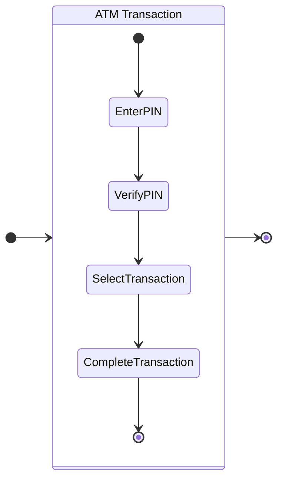

**Concurrent composite state – ATM operation**
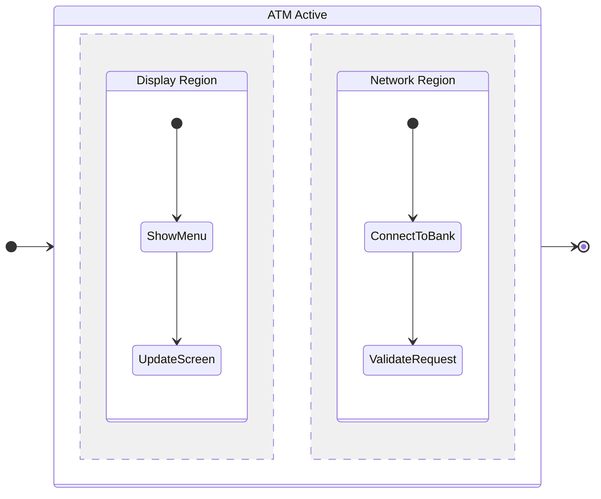

### Advantages
- Reduces complexity by grouping related states.
- Improves readability and organization.
- Allows common transitions at the composite-state level.
- Represents sequential and concurrent behavior.

**Conclusion:** Composite states organize complex behavior through nested states and may contain one sequential region or multiple concurrent regions.

---

## Q2. What is an Actor, a Use Case and a Use Case Diagram? Explain various relationships in a Use Case Diagram with examples.

1. **Actor:** A role played by an external person, device or system that interacts with the system. It is represented by a stick figure. Example: Customer or Bank Server.
2. **Use Case:** A function or service provided by the system to achieve an actor's goal. It is represented by an oval. Example: Withdraw Cash.
3. **Use Case Diagram:** A UML behavioral diagram showing the system's functional requirements, external actors and their interactions. A rectangle represents the system boundary.

### Relationships
1. **Association:** Communication link between an actor and a use case, shown by a solid line. Example: Customer — Withdraw Cash.
2. **Include:** Mandatory reuse of another use case. A dashed arrow labelled \`<<include>>\` points from the base use case to the included use case. Example: Withdraw Cash includes Validate PIN.
3. **Extend:** Optional or conditional behavior added to a base use case. A dashed arrow labelled \`<<extend>>\` points from the extending use case to the base use case. Example: Print Receipt extends Withdraw Cash.
4. **Generalization:** Inheritance between actors or use cases. A solid line with a hollow triangle points to the general parent. Example: Savings Account and Current Account specialize Account.

### Example
```mermaid
flowchart LR
    Customer@{ shape: person, label: "Customer" }
    Withdraw([Withdraw Cash])
    Validate([Validate PIN])
    Print([Print Receipt])
    Savings([Savings Account])
    Account([Account])

    Customer --- Withdraw
    Withdraw -. "<<include>>" .-> Validate
    Print -. "<<extend>>" .-> Withdraw
    Savings -.->|generalizes| Account
```

**Conclusion:** Actors represent external roles, use cases represent system functions, and relationships describe communication, reuse and specialization.

---

## Q3. Draw and explain a Use Case Diagram for ATM System. Explain at least two use cases with the help of Use Case Scenarios.

### Actors
- **Customer:** Performs banking transactions.
- **Bank Server:** Validates customer details and processes account requests.
- **Maintenance Staff:** Refills cash and maintains the ATM.

### Use Case Diagram
```mermaid
flowchart LR
    Customer@{ shape: person, label: "Customer" }
    Bank@{ shape: person, label: "Bank Server" }
    Staff@{ shape: person, label: "Maintenance Staff" }

    subgraph ATM["ATM System"]
        Withdraw([Withdraw Cash])
        Balance([Check Balance])
        Deposit([Deposit Cash])
        ChangePIN([Change PIN])
        Validate([Validate PIN])
        GetBalance([Get Balance])
        Update([Update Account])
        Verify([Verify PIN])
        Refill([Refill Cash])
        Maintain([Maintain ATM])
    end

    Customer --- Withdraw
    Customer --- Balance
    Customer --- Deposit
    Customer --- ChangePIN
    Bank --- Validate
    Bank --- GetBalance
    Bank --- Update
    Bank --- Verify
    Staff --- Refill
    Staff --- Maintain

    Withdraw -. "<<include>>" .-> Validate
    Withdraw -. "<<include>>" .-> Update
    Balance -. "<<include>>" .-> Validate
    Balance -. "<<include>>" .-> GetBalance
    Deposit -. "<<include>>" .-> Validate
    Deposit -. "<<include>>" .-> Update
    ChangePIN -. "<<include>>" .-> Verify
```

### Use Case Scenario 1 – Withdraw Cash

| Field | Description |
|---|---|
| Primary actor | Customer |
| Preconditions | ATM is operational; customer has a valid card and account. |
| Trigger | Customer selects Withdraw Cash. |
| Main flow | 1. Insert card. 2. Enter PIN. 3. System validates PIN. 4. Select account and enter amount. 5. Bank server checks balance. 6. ATM dispenses cash. 7. Transaction is recorded and receipt may be printed. |
| Alternative flow | Invalid PIN, insufficient account balance or insufficient ATM cash causes an error message and allows retry or cancellation. |
| Postcondition | Cash is dispensed and the transaction is recorded. |

### Use Case Scenario 2 – Check Balance

| Field | Description |
|---|---|
| Primary actor | Customer |
| Preconditions | Customer has a valid card and account. |
| Trigger | Customer selects Check Balance. |
| Main flow | 1. Insert card. 2. Enter PIN. 3. Validate PIN. 4. Select Check Balance. 5. ATM requests balance from bank server. 6. Server returns balance. 7. ATM displays it. |
| Alternative flow | Invalid PIN or unavailable bank service results in an error message. |
| Postcondition | Balance is displayed; no amount is withdrawn. |

**Conclusion:** The diagram identifies ATM actors and services. Use case scenarios describe normal and alternative steps for each service.

---

## Q4. Design a Use Case Diagram for an Online Reservation System.

### Actors
- **Customer:** Searches and books a service or ticket.
- **Administrator:** Manages users, reservations and availability.
- **Payment Gateway:** Processes online payments.

### Use Case Diagram
```mermaid
flowchart LR
    Customer@{ shape: person, label: "Customer" }
    Admin@{ shape: person, label: "Administrator" }
    Gateway@{ shape: person, label: "Payment Gateway" }

    subgraph Reservation["Online Reservation System"]
        Login([Register / Login])
        Search([Search Availability])
        Details([View Details])
        Make([Make Reservation])
        Enter([Enter Details])
        Pay([Process Payment])
        Confirm([Confirm Reservation])
        View([View Reservation])
        Cancel([Cancel Reservation])
        Availability([Manage Availability])
        Manage([Manage Reservations])
    end

    Customer --- Login
    Customer --- Search
    Customer --- Details
    Customer --- Make
    Customer --- Confirm
    Customer --- View
    Customer --- Cancel
    Admin --- Availability
    Admin --- Manage
    Gateway --- Pay

    Make -. "<<include>>" .-> Enter
    Make -. "<<include>>" .-> Pay
```

### Explanation
1. Customer registers or logs in.
2. Customer searches availability and views options.
3. Customer selects an option and enters reservation details.
4. The system processes payment through the Payment Gateway when payment is required.
5. After successful payment, the system confirms and stores the reservation.
6. Customer can view or cancel an existing reservation, subject to cancellation rules.
7. Administrator manages availability and reservation records.

**Relationships:** Make Reservation may include Enter Details. Where payment is mandatory, it may include Process Payment. Optional actions can be modeled as extensions when required by system rules.

**Conclusion:** The diagram represents interactions of customers, administrators and the payment gateway with the reservation system.

---

## Q5. What is a Sequence Model? Explain with a suitable example. Also explain the different components of a Sequence Diagram.

A **Sequence Model** represents interactions among objects in chronological order. It shows messages exchanged between objects to perform a use case or operation. A Sequence Diagram is its graphical representation.

### Components
1. **Actor:** External role participating in the interaction; shown as a stick figure.
2. **Object / Participant:** Instance taking part in the interaction; shown as a named rectangle.
3. **Lifeline:** Dashed vertical line showing the participant's existence.
4. **Activation Bar:** Thin rectangle showing the period during which a participant executes an operation.
5. **Message:** Horizontal arrow representing communication. Synchronous messages use a filled arrowhead; asynchronous messages use an open arrowhead; return messages use a dashed arrow; a self-message loops back to the same lifeline.
6. **Destruction Occurrence:** An X at the end of a lifeline indicates that the object is destroyed.

### Example – ATM Cash Withdrawal
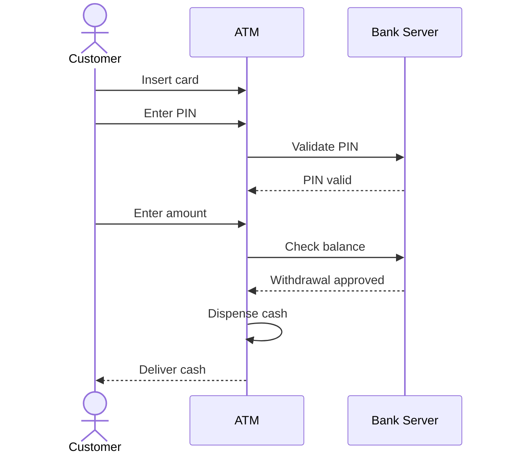

**Conclusion:** A Sequence Diagram explains which participants communicate, what messages they exchange and the order in which messages occur.

---

## Q6. Draw a detailed Sequence Diagram for an Online Shopping System.

### Participants
Customer, Shopping Application, Product Catalogue, Cart, Order Service, Payment Gateway and Inventory Service.

### Sequence Diagram
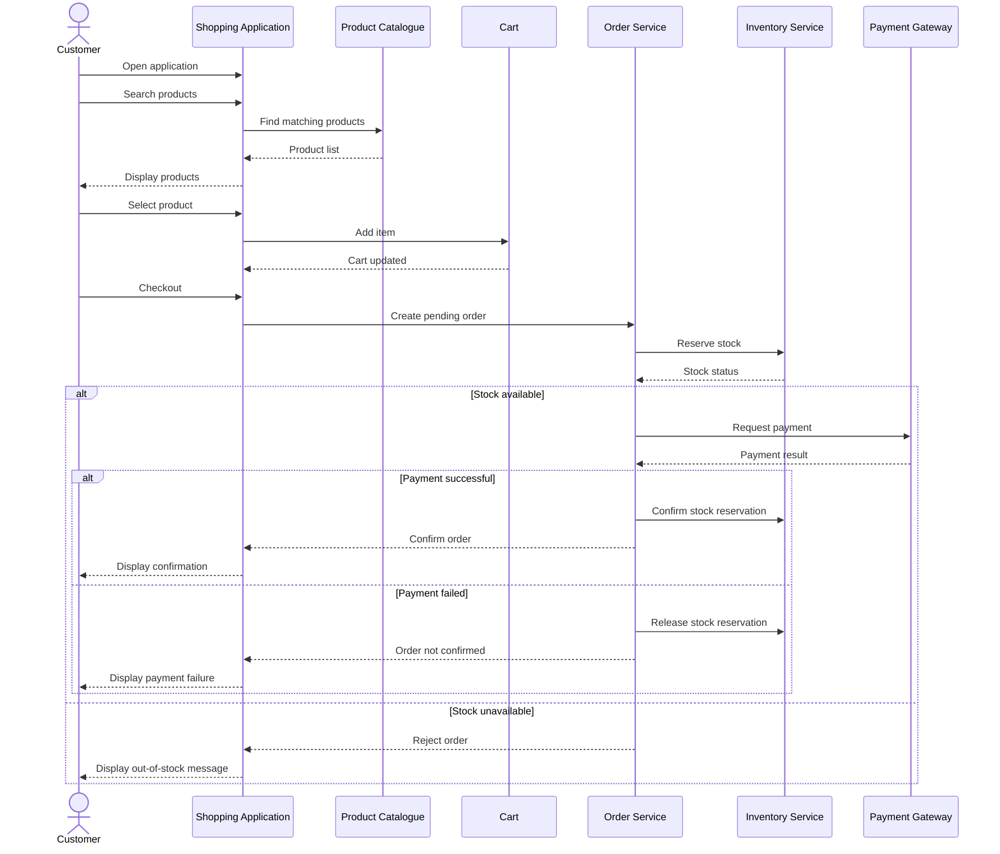

### Explanation
1. Customer searches for products and the application retrieves matching products from the catalogue.
2. Customer selects a product and adds it to the cart.
3. At checkout, the Order Service creates a pending order and checks or reserves stock.
4. If stock is available, the Payment Gateway processes payment.
5. On successful payment, the order is confirmed and the customer receives confirmation. If payment fails, the order remains unconfirmed and any stock reservation is released according to system rules.

**Conclusion:** The sequence diagram shows the chronological messages exchanged among the customer, application and supporting services during an online purchase.

---

## Q7. Model a Sequence Diagram for Rent a Car in an online web-based car rental application. Explain the sequence of car selection, availability checking, booking, confirmation and storage of booking details.

### Participants
Customer, Rental Application, Car Database, Availability Service, Booking Service and Notification Service.

### Sequence Diagram
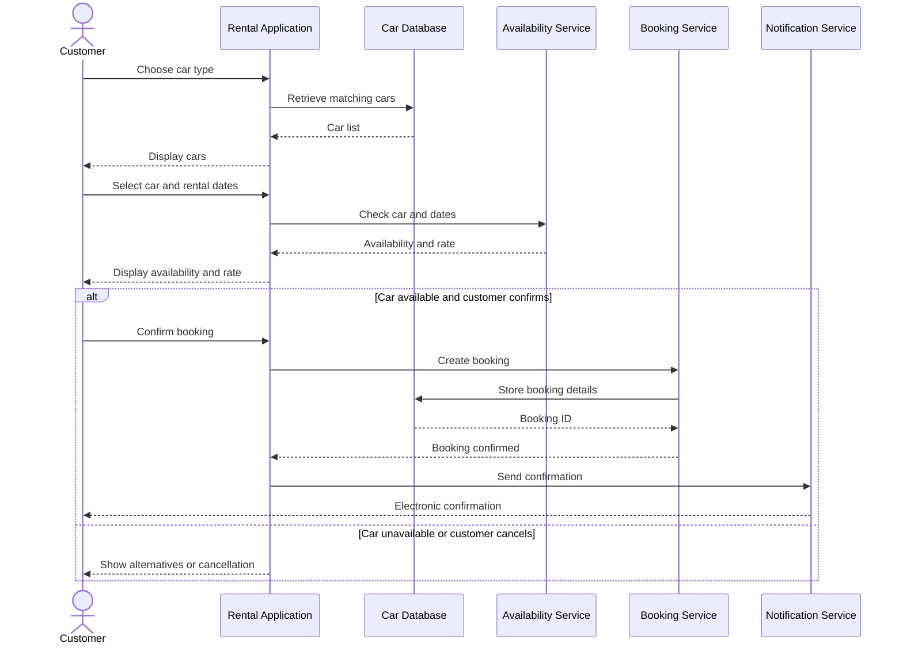

### Explanation
1. Customer selects a car category, such as family car or sports car.
2. Rental Application retrieves matching cars from the Car Database.
3. Customer selects a car and rental dates.
4. Availability Service checks whether the car is available for the selected period.
5. The application displays the applicable rental rate.
6. Customer confirms the booking.
7. Booking Service creates the booking and stores customer, car, dates and rate.
8. Notification Service sends an electronic confirmation.

**Conclusion:** The sequence model shows interactions from car selection and availability checking to booking storage and electronic confirmation.

---

## Q8. What do you mean by Activity? Consider the ATM System scenario. Identify and explain at least three activities involved in the ATM System scenario.

An **Activity** is a behavior consisting of coordinated actions performed to achieve a goal. An Activity Diagram represents workflow and control flow among actions.

### Activities in an ATM System
1. **Card and PIN Verification:** Customer inserts the card and enters the PIN. ATM sends details for validation. If invalid, an error is displayed.
2. **Cash Withdrawal:** Customer selects withdrawal and enters an amount. The system checks account balance and ATM cash availability. If approved, cash is dispensed and transaction is recorded.
3. **Balance Enquiry:** Customer selects balance enquiry. ATM requests the account balance from the bank server and displays the result.
4. **Cash Deposit:** Customer selects deposit and inserts cash or deposit details. The system records the deposit and updates the account according to bank processing rules.
5. **PIN Change:** Customer selects PIN change, verifies the existing PIN and enters a new PIN. The system validates and updates it.

### Activity Diagram – Cash Withdrawal
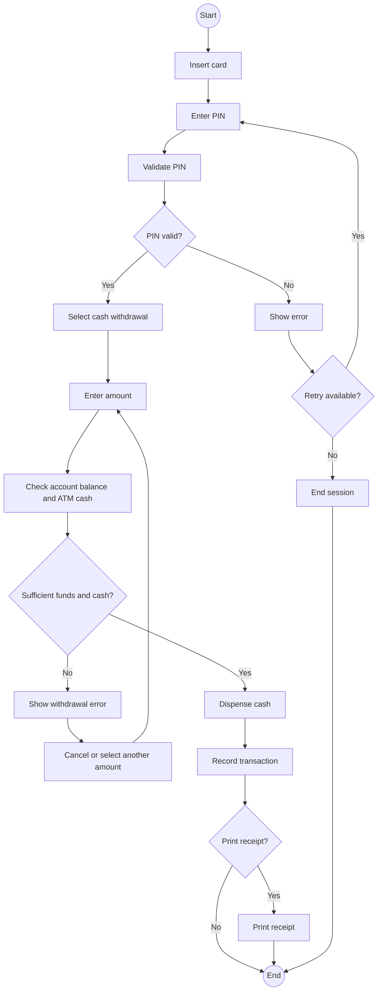

**Conclusion:** ATM activities describe individual banking operations. The diagram shows workflow and decisions involved in cash withdrawal.

---

## Q9. Compare Sequence Diagram and Activity Diagram.

| Parameter | Sequence Diagram | Activity Diagram |
|---|---|---|
| Purpose | Represents interactions among participants. | Represents workflow of activities in a process. |
| Main focus | Order of messages exchanged over time. | Order and flow of actions or activities. |
| Elements | Actors, objects, lifelines, activation bars and messages. | Actions, control flows, initial/final nodes and decision nodes. |
| Time representation | Time progresses from top to bottom. | Shows control flow, not a timeline of object messages. |
| Communication | Shows which participant sends a message to another. | Does not primarily show object-to-object messages. |
| Branching | Uses combined fragments such as alt and opt. | Uses decision and merge nodes. |
| Concurrency | Can show concurrent messages and parallel interaction fragments. | Uses fork and join nodes. |
| Example | Customer, ATM and Bank Server exchanging messages. | Steps involved in ATM cash withdrawal. |

### Simple Difference in Representation

**Sequence Diagram**
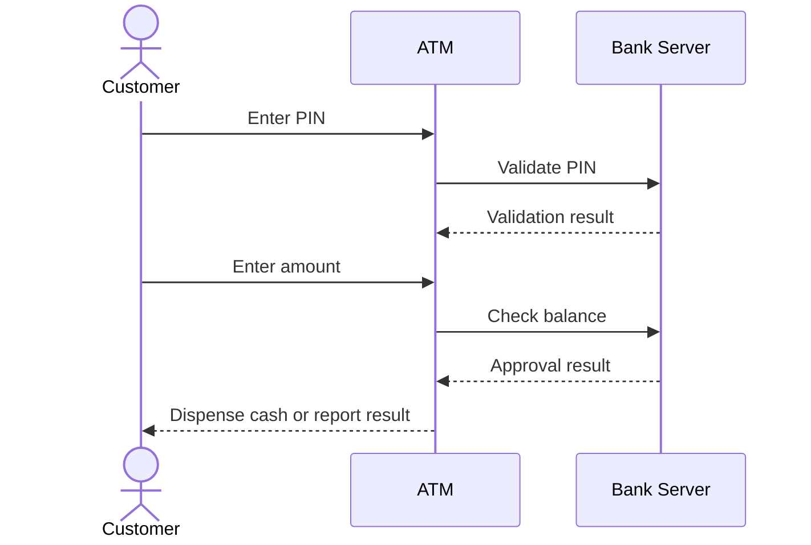

**Activity Diagram**
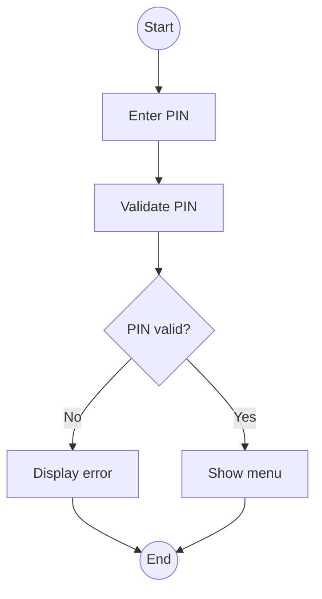

**Conclusion:** A Sequence Diagram answers which participant communicates with whom and in what order. An Activity Diagram answers what steps are performed and how the workflow proceeds.

---

## Q10. Draw an Activity Diagram for ATM Machine.

### Activity Diagram
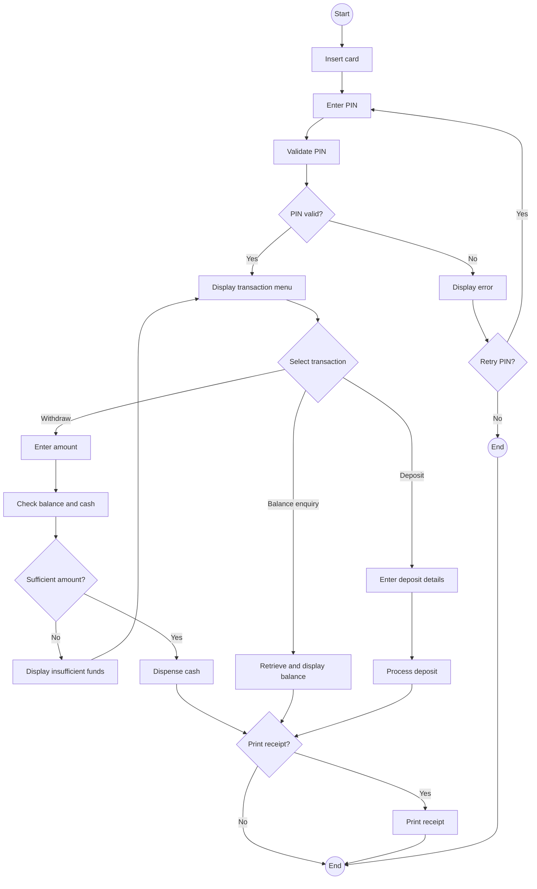

### Explanation
1. Customer inserts the ATM card and enters the PIN.
2. ATM validates the PIN. If invalid, an error is displayed and the customer may retry.
3. After successful validation, the ATM displays the transaction menu.
4. Customer selects withdrawal, balance enquiry or deposit.
5. For withdrawal, the system checks the balance and dispenses cash if sufficient funds are available.
6. For balance enquiry, the system retrieves and displays the balance.
7. For deposit, the system processes the deposit and updates the account record.
8. The ATM may print a receipt and then ends the session.

**Conclusion:** The diagram represents the main ATM workflow, including transaction selection and alternative paths based on PIN validity and available balance.

---

## Q11. What do you mean by Activity? How are activities, branches and concurrent activities represented? Prepare an Activity Diagram for logging into an email system.

### 1. Activity
An **Activity** is a sequence of actions performed to complete a task or achieve a goal.

### 2. Representation
- **Activity / Action:** Rounded rectangle representing a task such as Enter Password.
- **Branch (Decision):** Diamond-shaped node splitting the flow into alternative paths based on guard conditions such as [valid] and [invalid].
- **Merge:** Diamond-shaped node bringing alternative paths back into one flow.
- **Concurrent Activities:** A thick bar represents a fork when one flow splits into parallel flows and a join when parallel flows synchronize.

### 3. Activity Diagram – Email Login
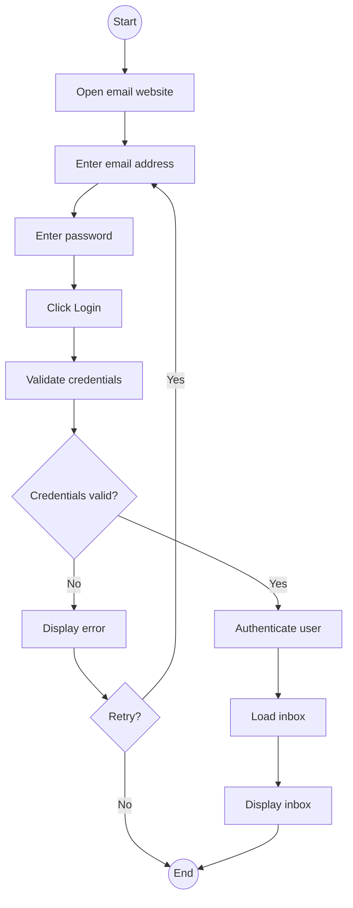

### Explanation
1. User opens the email website or application.
2. User enters the email address and password.
3. System validates the credentials.
4. If invalid, an error message is displayed and the user can try again.
5. If valid, the system authenticates the user, loads the mailbox and displays the inbox.

**Conclusion:** Activity diagrams represent actions, alternative branches and concurrent flows. In email login, a decision node selects either the error path or successful authentication path.

---

## Q12. Draw an Activity Diagram for Hospital Management System.

### Activity Diagram
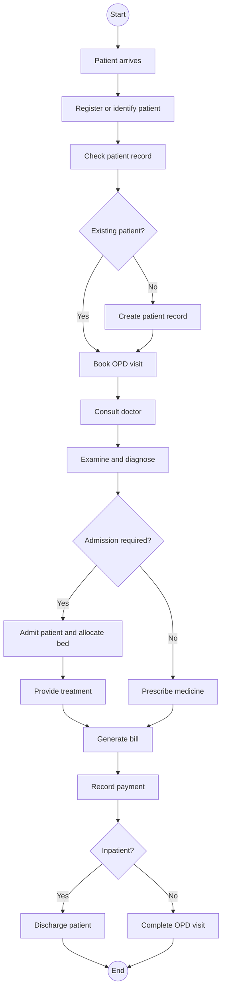

### Explanation
1. Patient arrives and is registered or identified using an existing record.
2. System books an OPD visit and the patient consults a doctor.
3. Doctor examines the patient and records a diagnosis.
4. If admission is required, the hospital admits the patient, allocates a bed and provides treatment.
5. Otherwise, the doctor prescribes medicines and completes the OPD visit.
6. Billing generates the bill and records payment.
7. Patient completes the visit or is discharged after treatment.

**Conclusion:** The Activity Diagram represents the patient workflow from registration and consultation to treatment, billing and completion or discharge.

---

## Q13. Draw an Activity Diagram for describing how selling a two-wheeler to a customer takes place at a dealer's place. Explain the notations used.

### Activity Diagram
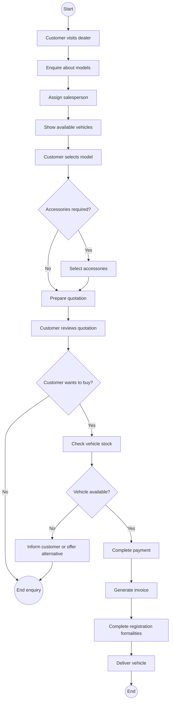

### Explanation
1. Customer visits the dealership and enquires about available two-wheeler models.
2. A salesperson is assigned and shows available vehicles.
3. Customer selects a model and may optionally select accessories such as a rear guard.
4. Salesperson prepares a quotation covering the vehicle and selected accessories.
5. If the customer is not interested, the enquiry ends. If interested, stock is checked.
6. If the vehicle is available, payment is completed, an invoice is generated, registration formalities are completed and the vehicle is delivered.

### UML Notations Used

| Notation | Meaning |
|---|---|
| Initial node (filled circle) | Starting point of the workflow. |
| Activity (rounded rectangle) | Represents an action or task. |
| Control flow (arrow) | Shows the order of execution. |
| Decision node (diamond) | Selects a path based on a condition. |
| Guard condition ([Yes], [No]) | Specifies the condition for following a branch. |
| Merge node (diamond) | Combines alternative paths into one flow. |
| Final node (bull's-eye) | Indicates completion of the activity. |

**Conclusion:** The diagram models the two-wheeler sales process from enquiry and model selection to quotation, payment, registration and delivery.

---

## Q14. What is an Interaction Diagram? Explain the different components of a Sequence Diagram.

An **Interaction Diagram** is a UML behavioral diagram showing how objects or participants communicate by exchanging messages to perform a task. It represents dynamic behavior.

Common interaction diagrams include Sequence, Communication (Collaboration), Interaction Overview and Timing Diagrams.

### Components of a Sequence Diagram
1. **Actor:** External role interacting with the system; shown as a stick figure.
2. **Object / Participant:** Instance involved in the interaction; shown in a rectangle at the top.
3. **Lifeline:** Vertical dashed line showing the participant's existence.
4. **Activation Bar:** Narrow rectangle on a lifeline showing the period of execution.
5. **Messages:** Arrows between lifelines showing communication. Common types are synchronous, asynchronous, return and self-message.
6. **Destruction Occurrence:** An X marking the end of an object's lifeline when destroyed.

### Example – ATM Interaction
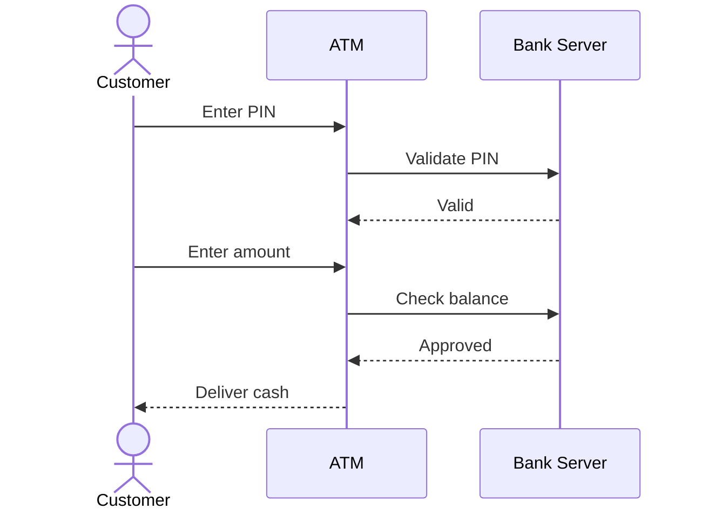

**Conclusion:** An Interaction Diagram models communication among objects. A Sequence Diagram specifically emphasizes chronological order of exchanged messages.

---

## Q15. Explain the relationship between Class Model and State Model.

### Class Model
The **Class Model** represents the static structure of a system. It defines classes, attributes, operations and relationships among classes.

### State Model
The **State Model** represents the dynamic behavior of an object. It shows the states through which the object passes and the events that cause transitions.

### Relationship
1. The Class Model identifies classes; the State Model describes the life cycle of objects belonging to those classes.
2. Attributes in a class may influence the state of its objects.
3. Operations defined in classes may be invoked by events or actions in state transitions.
4. The State Model explains state-dependent behavior of objects.
5. Both models must be consistent: states, events and operations should relate to classes in the Class Model.

### Example – Bank Account
**Class Model:** Account may have attributes accountNumber, balance and status, and operations deposit(), withdraw() and block().

**State Model**
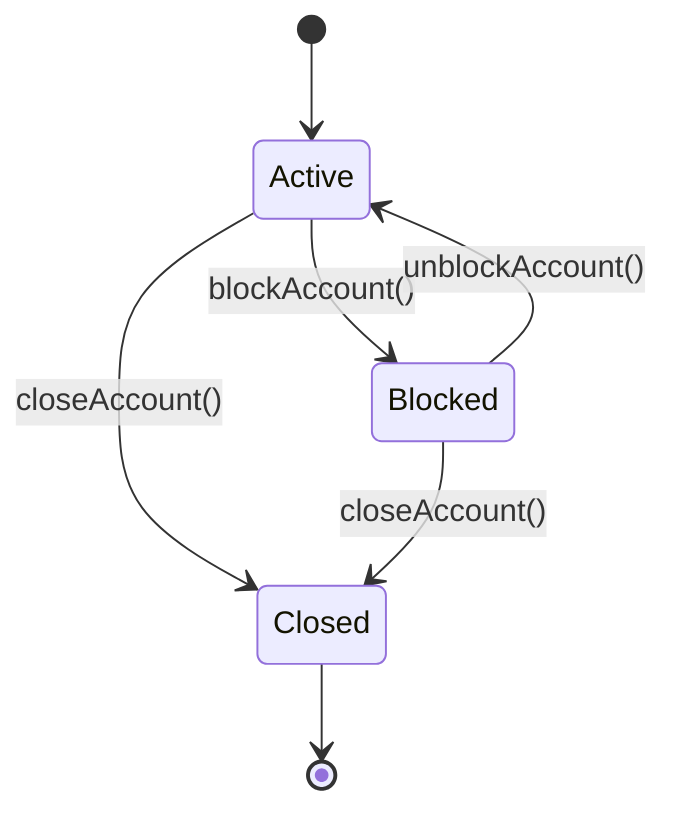

The Class Model defines the Account class and its features; the State Model describes how an Account object changes from Active to Blocked or Closed.

**Conclusion:** The Class Model describes what objects exist and their structure, while the State Model describes how those objects behave over time. They complement each other.

---

## Q16. Draw a State Diagram for Cash Dispenser and explain concurrency.

### State Diagram – Cash Dispenser
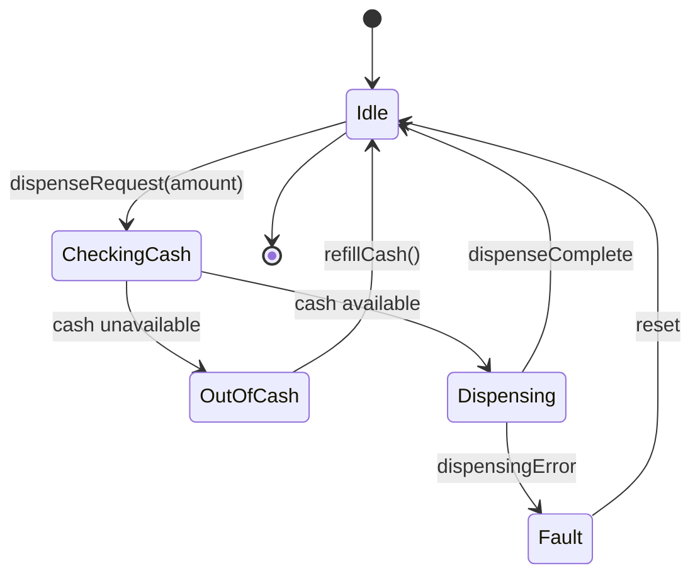

### Explanation
1. **Idle:** Dispenser waits for a dispense request.
2. **Check Cash Availability:** System checks whether the requested amount can be dispensed.
3. **Out of Cash:** If sufficient cash is unavailable, the dispenser waits for authorized replenishment.
4. **Dispensing:** If cash is available, the dispenser operates the cash mechanism.
5. **Return to Idle:** After dispensing, the dispenser becomes ready for another request.

### Concurrency
**Concurrency** means two or more independent state activities can proceed at the same time. In a UML State Diagram, concurrency is represented by a composite state containing two or more **orthogonal regions**, separated by a divider.

Example: While a cash dispenser is active, its dispensing mechanism handles a request while a monitoring region independently monitors cash levels and reports low cash.

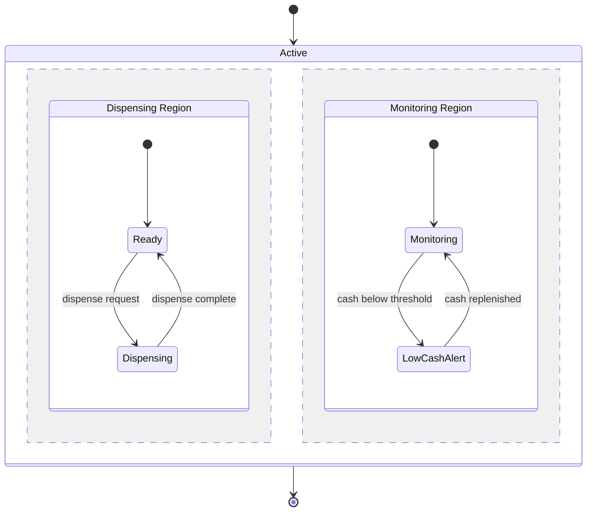

The two regions are active concurrently; one controls dispensing while the other monitors cash availability.

**Conclusion:** The Cash Dispenser State Diagram shows its operating states and transitions. Concurrency is modeled using orthogonal regions inside a composite state.

---

## Q17. Draw a State Diagram for Telephone Line Connection. Explain Event, State and Transition in the diagram.

### State Diagram
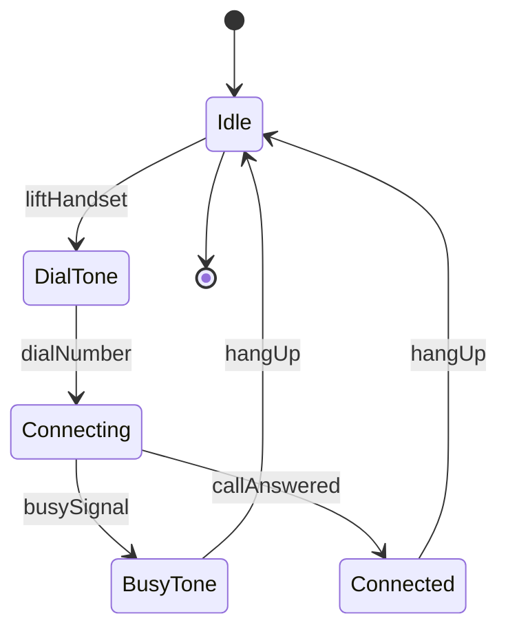

### 1. State
A **State** is a condition of an object at a particular time. Telephone line states include:
- **Idle:** No active call; line is waiting.
- **Dial Tone:** Handset is lifted and the system is ready to receive a number.
- **Connecting:** The system is attempting to establish the call.
- **Busy Tone:** The called line is busy.
- **Connected:** The call is established and conversation can take place.

### 2. Event
An **Event** is an occurrence that may trigger a state change. Examples are liftHandset, dialNumber, busySignal, callAnswered and hangUp.

### 3. Transition
A **Transition** is movement from one state to another due to an event. Examples:
- Idle → Dial Tone on liftHandset.
- Dial Tone → Connecting on dialNumber.
- Connecting → Busy Tone on busySignal.
- Connecting → Connected on callAnswered.
- Connected → Idle on hangUp.

**Conclusion:** The diagram models the telephone call life cycle. Events trigger transitions between states and describe dynamic behavior.

---

## Q18. Explain the Use Case Description for Buying a Beverage.

A **Use Case Description** is a textual specification of how an actor interacts with a system to achieve a goal. The use case *Buying a Beverage* describes how a customer purchases a drink from a beverage vending machine.

### Use Case Description

| Field | Description |
|---|---|
| Use case name | Buying a Beverage |
| Primary actor | Customer |
| Goal | Purchase a selected beverage. |
| Preconditions | Vending machine is operational and the selected beverage is available. |
| Trigger | Customer starts a purchase by selecting a beverage. |
| Postconditions | Beverage is dispensed and payment is accepted; change is returned if applicable. |

### Main Flow
1. Customer approaches the vending machine.
2. Machine displays available beverages and prices.
3. Customer selects a beverage.
4. Machine displays the selected beverage's price.
5. Customer inserts the required money or selects an accepted payment method.
6. Machine verifies the payment.
7. Machine dispenses the selected beverage.
8. Machine returns any applicable change and completes the transaction.

### Alternative Flows
- **Insufficient payment:** Machine asks the customer to add money or cancel the transaction.
- **Beverage out of stock:** Machine displays an unavailable message and asks the customer to choose another beverage or cancel.
- **Cancel transaction:** Machine cancels the purchase and returns inserted money, subject to payment method rules.
- **Machine failure:** Machine displays an error and does not mark the purchase as completed.

**Conclusion:** The use case description explains the normal and alternative interactions required for a customer to buy a beverage from a vending machine.
