# OOMD – Unit IV: Complete Exam Answers

**Subject:** Object Oriented Modeling and Design (410244(D))  
**Unit:** User Application Analysis and System Design  
**University:** Savitribai Phule Pune University (SPPU)  
**Course:** Fourth Year Computer Engineering – 2019 Course  
**Exam:** End-Semester, 70 Marks

---

## Q1. Write a short note on Architectural Styles. Enlist different Architectural Styles followed in Software Design and explain any four in detail.

**PYQ frequency:** 6/6 | **Marks:** 5–7 | **Priority:** Very High

### 1. Introduction
An **Architectural Style** defines the overall structure and organization of a software system. It describes how components are organized, how they interact and how data flows between them.

### 2. Different Architectural Styles
1. Data-Centered Architecture
2. Data-Flow Architecture
3. Call-and-Return Architecture
4. Object-Oriented Architecture
5. Layered Architecture

### 3. Explanation

**1. Data-Centered Architecture**
- A central data store or repository is maintained.
- Different components access and modify data through the central repository.
- Components communicate indirectly by reading or writing data.
- Example: Database management systems and library management systems.

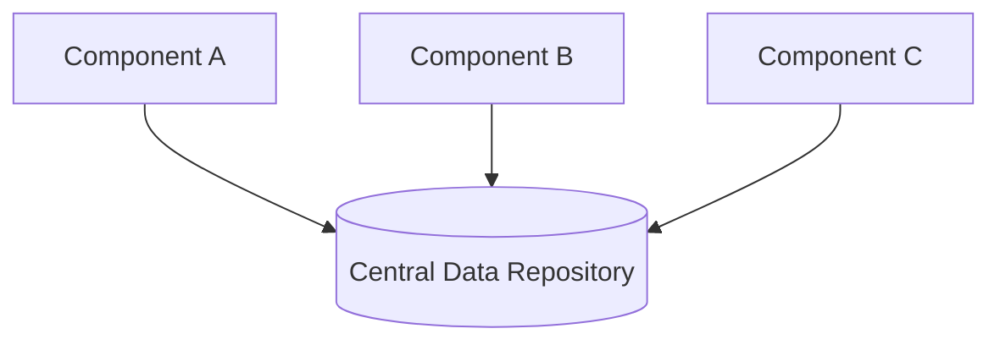

Advantages: Centralized data management, easier data sharing and reduced duplication.

**2. Data-Flow Architecture**
- Data moves through a sequence of processing components.
- Each component performs a specific operation and passes its output to the next component.
- Suitable when data undergoes multiple processing stages.
- Example: Compiler phases such as lexical analysis, syntax analysis and code generation.

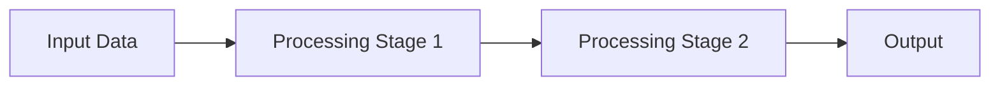

Advantages: Independent processing stages, component reuse and easier maintenance.

**3. Call-and-Return Architecture**
- The system is divided into modules or functions.
- One module calls another to perform a task.
- The called module returns control to the calling module after execution.
- Example: A banking program calling deposit, withdrawal and balance-enquiry functions.

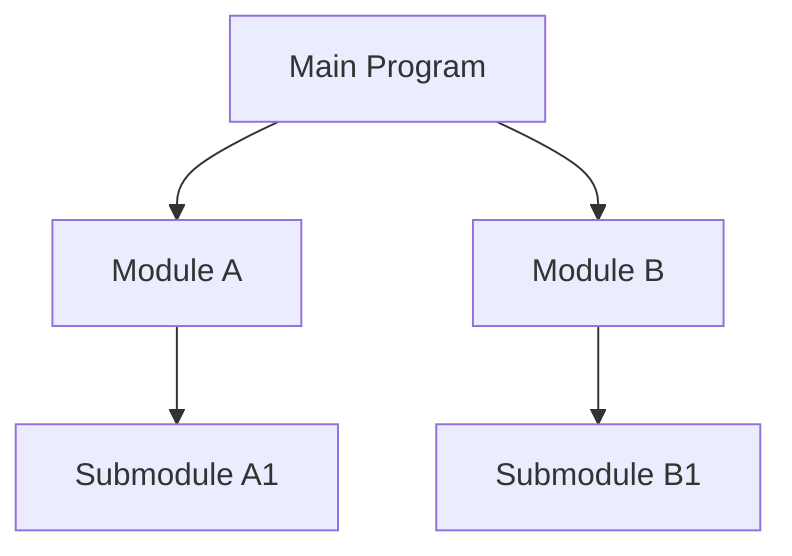

Advantages: Modular programming, clear execution sequence and easier testing/debugging.

**4. Object-Oriented Architecture**
- The system is organized around objects rather than only functions.
- Objects encapsulate data and operations.
- Objects communicate through method calls or messages.
- It uses abstraction, encapsulation, inheritance and polymorphism.
- Example: A hospital system containing Patient, Doctor, Appointment and Billing objects.

Advantages: Code reuse, modularity, maintainability and effective representation of real-world entities.

**5. Layered Architecture**
- The system is divided into layers, each with a specific responsibility.
- A layer provides services to the layer above and uses services from the layer below.
- Example: A web application with presentation, business, data-access and database layers.

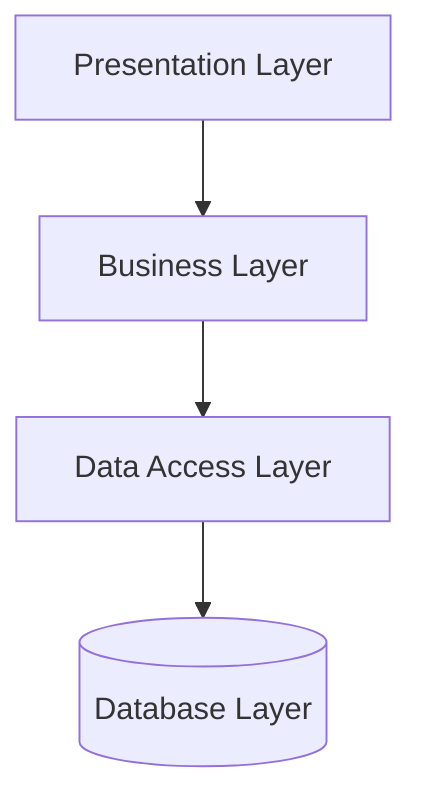

Advantages: Separation of responsibilities, easier testing and maintenance, and independent evolution of layers when interfaces remain stable.

### 4. Conclusion
Architectural styles provide structured ways to organize software components and define their interactions. Selecting a suitable style improves software quality, reusability and maintainability.

---

## Q2. What are the different categories of External Control? Explain in detail.

**PYQ frequency:** 6/6 | **Marks:** 5–6 | **Priority:** Very High

### 1. Introduction
External control is a software control strategy in which the flow of control is managed by a separate control mechanism rather than by individual objects.

### 2. Categories of External Control

**1. Procedure-Driven Control**
- The flow of control is determined by a sequence of procedures or function calls.
- One procedure calls another to perform a task.
- After execution, the called procedure returns control to the calling procedure.
- The main program or control module manages the execution sequence.
- Example: A banking program calls customer verification, account validation and transaction-processing procedures.

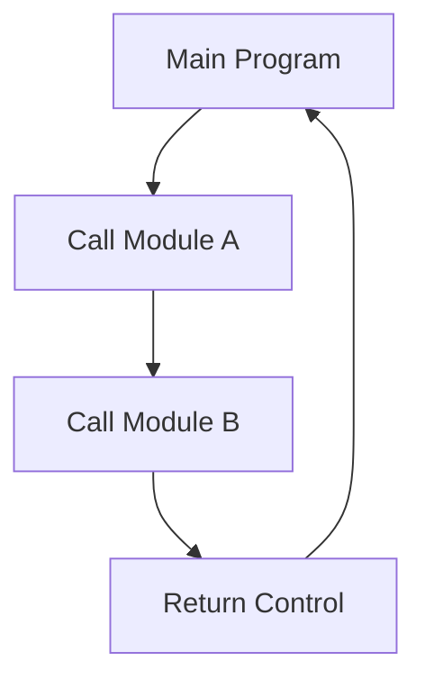

Advantages: Simple to understand, clear execution sequence and modular programming.

**2. Event-Driven Control**
- The flow of control depends on the occurrence of events.
- Events may be generated by users, external devices or software components.
- The system responds by executing the operation associated with an event.
- Suitable for interactive and real-time applications.

**A. Broadcast-Based Control**
- An event is broadcast to multiple registered objects or components.
- Interested components receive the notification and decide how to respond.
- It provides loose coupling.
- Example: Patient registration may notify appointment, billing and medical-record components.

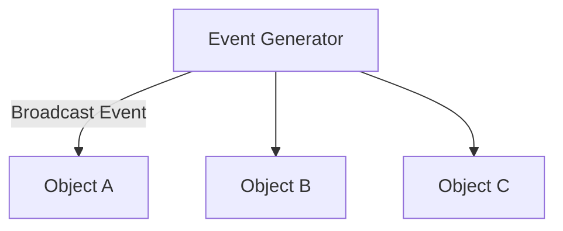

**B. Interrupt-Driven Control**
- An interrupt temporarily interrupts normal program execution.
- Control transfers to a specific interrupt handler.
- After handling the interrupt, execution resumes.
- Example: A keyboard key press generates an interrupt handled by the operating system.

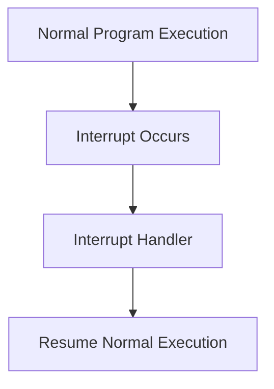

### 3. Conclusion
Procedure-driven control follows a predefined sequence of calls, whereas event-driven control responds to events through broadcasting or interrupts.

---

## Q3. Explain External Control and Internal Control.

**PYQ frequency:** 1/6 | **Marks:** 5 | **Priority:** Low

### 1. External Control
External control is a strategy in which flow of control is managed by a separate mechanism.
- A central controller or external events determine the execution sequence.
- Procedure-driven control uses procedure/function calls.
- Event-driven control responds through broadcasting or interrupts.
- Example: A banking controller coordinates customer verification, account validation and transaction processing.

### 2. Internal Control
Internal control is a strategy in which individual objects are responsible for controlling their own behavior.
- Each object maintains its internal state and responds to messages or events.
- Objects communicate through message passing.
- An object determines which operation to perform based on its current state.
- Example: A Patient object changes from Registered to Under Treatment and then Discharged when appropriate events occur.

### 3. Difference

| External Control | Internal Control |
|---|---|
| Control is managed by a separate mechanism. | Control is managed by individual objects. |
| A controller or external events determine execution. | Objects determine their own behavior. |
| Focuses on overall flow of control. | Focuses on individual object behavior. |
| Often uses procedure calls or event handling. | Commonly uses object communication and state transitions. |
| Execution is coordinated externally. | Objects respond according to internal states. |

### 4. Conclusion
External control manages execution through an external mechanism, whereas internal control allows individual objects to manage their own behavior.

---

## Q4. Explain Global Resource Handling in System Design.

**PYQ frequency:** 4/6 | **Marks:** 5–6 | **Priority:** Very High

### 1. Introduction
Global resources are resources shared by multiple subsystems or components. **Global Resource Handling** identifies, manages and controls access to these shared resources. Examples include databases, files, printers, memory, communication channels and hardware devices.

### 2. Global Resource Handling
1. **Centralized Resource Management:** A central manager controls access to shared resources. Subsystems request resources through this manager.
2. **Resource Allocation:** Resources are allocated according to subsystem requirements to avoid conflicts and unnecessary waiting.
3. **Synchronization:** Simultaneous access is controlled to prevent inconsistent updates. Locks, semaphores and mutexes may be used.
4. **Resource Sharing:** Components share resources according to defined access permissions and rules.
5. **Deadlock Prevention and Handling:** Allocation and locking strategies are selected to prevent or recover from processes waiting indefinitely for resources held by one another.

### 3. Diagram

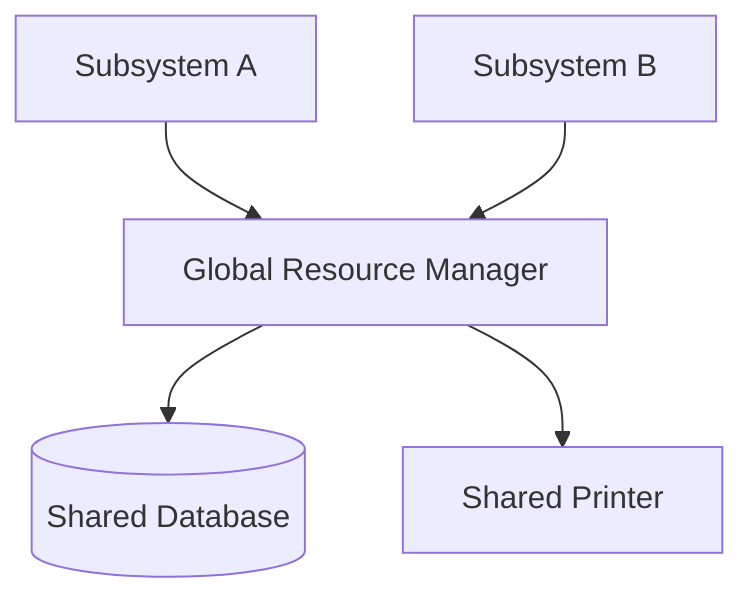

### 4. Advantages
- Ensures controlled access to shared resources.
- Prevents resource conflicts and data inconsistency.
- Improves resource utilization.
- Coordinates different subsystems.
- Improves reliability and performance.

### 5. Conclusion
Global Resource Handling ensures proper allocation, sharing and synchronization of resources among subsystems.

---

## Q5. Explain Data Storage Management in Software Modelling.

**PYQ frequency:** 3/6 | **Marks:** 5–6 | **Priority:** High

### 1. Introduction
Data Storage Management determines how and where system data will be stored, organized, accessed and maintained. It supports efficient storage, retrieval, security and consistency.

### 2. Data Storage Management
1. **Selection of Storage Method:** Select a suitable relational database, file system or other technology. Examples: MySQL, PostgreSQL and Oracle.
2. **Data Organization:** Organize data into tables, records, files or objects and define relationships to reduce duplication.
3. **Data Access and Retrieval:** Design efficient create, read, update and delete operations. Indexing and query optimization can improve retrieval.
4. **Data Security:** Use authentication and access control. Backup and recovery mechanisms help prevent data loss.
5. **Data Consistency and Integrity:** Apply constraints, validation and transactions to maintain accurate data.
6. **Data Distribution:** Distribute data across servers or locations when required for availability, scalability and performance.

### 3. Diagram

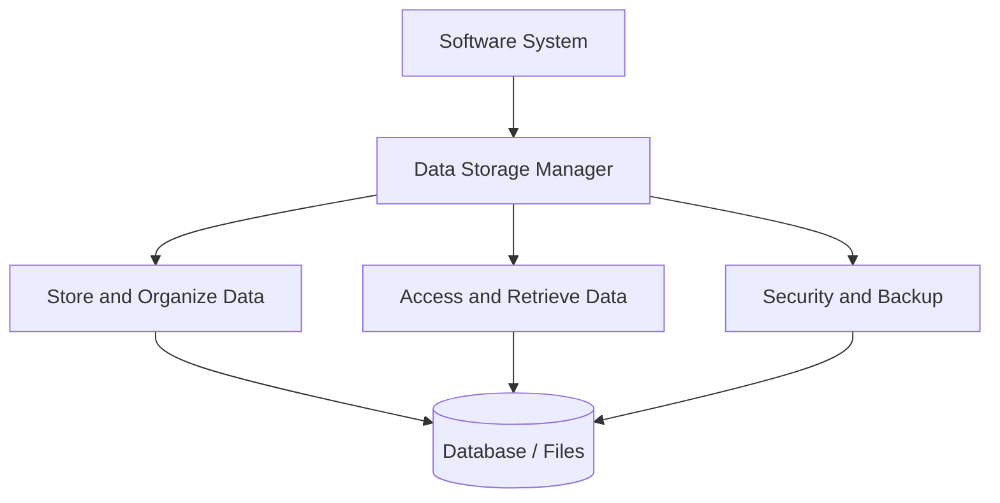

### 4. Advantages
- Improves storage and retrieval efficiency.
- Reduces duplication and inconsistency.
- Provides security and reliability.
- Supports backup and recovery.
- Improves performance and scalability.

### 5. Conclusion
Data Storage Management ensures that system data is properly stored, organized, accessed and protected.

---

## Q6. Define Reuse Plan. Explain the following terms with respect to Reuse Plan: (i) Library (ii) Framework (iii) Pattern.

**PYQ frequency:** 3/6 | **Marks:** 5–6 | **Priority:** High

### 1. Definition of Reuse Plan
A **Reuse Plan** is a systematic approach that identifies existing software components, frameworks, libraries and design patterns that can be reused in a new system. It reduces development time, cost and effort while improving quality and reliability.

### 2. Terms Related to Reuse Plan

**(i) Library**
- A collection of pre-written and reusable software components, functions or classes.
- Developers call required library functions from their application.
- The application generally controls the flow of execution.
- Example: Java Collections classes such as ArrayList and HashMap, or Python's Math library.

**(ii) Framework**
- A reusable software structure that provides a foundation for developing applications.
- Contains predefined components, classes and rules.
- The framework generally controls application flow and calls developer-written code when required. This is known as Inversion of Control.
- Example: Spring Boot and Angular.

**(iii) Pattern**
- A reusable and proven solution to a commonly occurring software design problem.
- Describes a general solution rather than ready-made code.
- Developers adapt it to application requirements.
- Example: Singleton ensures a class has one instance; Factory provides an approach for object creation.

### 3. Difference

| Library | Framework | Pattern |
|---|---|---|
| Collection of reusable code. | Reusable application structure. | Reusable design solution. |
| Provides functions and classes. | Provides architecture and components. | Provides guidelines for design problems. |
| Application calls the library. | Framework controls application flow. | Developer implements the solution. |
| Example: Java Collections. | Example: Spring Boot. | Example: Singleton. |

### 4. Advantages
- Reduces development time and cost.
- Avoids code duplication.
- Improves software quality and reliability.
- Promotes standardization and maintainability.

### 5. Conclusion
Libraries provide reusable code, frameworks provide reusable application structures, and patterns provide reusable solutions to common design problems.

---

## Q7. Explain Batch Transformation and Continuous Transformation.

**PYQ frequency:** 3/6 | **Marks:** 5–7 | **Priority:** High

### 1. Introduction
Transformation converts input data into the required output by applying processing operations. Two approaches are Batch Transformation and Continuous Transformation.

### 2. Batch Transformation
- Data is collected and stored before processing.
- A complete batch is processed together.
- Processing starts after a predefined amount of data is collected or at a scheduled time.
- Output is generated after the batch has been processed.
- Suitable when immediate processing is not required.

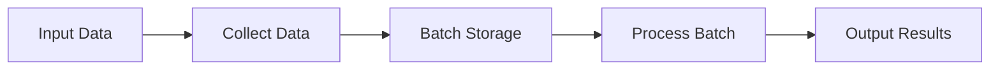

Examples: Monthly salary processing, bank statement generation and examination result processing.

Advantages: Efficient for large volumes, reduces repeated processing overhead and supports scheduled operations.

### 3. Continuous Transformation
- Input data is processed continuously as soon as it becomes available.
- Data is processed in small units rather than waiting for a complete batch.
- Output is generated continuously.
- Suitable for immediate or near-real-time processing.

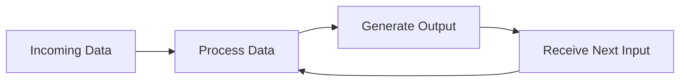

Examples: Online banking transactions, real-time stock updates and sensor monitoring.

Advantages: Quick processing, supports real-time applications and reduces waiting time.

### 4. Difference

| Batch Transformation | Continuous Transformation |
|---|---|
| Processes data in groups. | Processes data as it arrives. |
| Input is collected before processing. | Input is processed continuously. |
| Output after batch processing. | Output generated continuously. |
| Usually greater processing delay. | Usually lower processing delay. |
| Suitable for scheduled operations. | Suitable for real-time applications. |
| Example: Monthly salary. | Example: Online banking. |

### 5. Conclusion
Batch Transformation processes collected data in groups, whereas Continuous Transformation processes data as it arrives.

---

## Q8. What is meant by a Subsystem in System Design? Explain breaking a system into subsystems and allocation of subsystems.

**PYQ frequency:** 3/6 | **Marks:** 6–7 | **Priority:** High

### 1. Definition of Subsystem
A **Subsystem** is a collection of related classes, objects and components that work together to perform a specific function within a larger system. It has a defined responsibility and communicates through interfaces.

Example: Patient Management, Appointment Management, Billing and Pharmacy in a Hospital Management System.

### 2. Breaking a System into Subsystems
Breaking a system into subsystems means dividing a large system into smaller, manageable and functionally related units.

1. **Identify Major Functions:** Identify the main functions and responsibilities.
2. **Group Related Classes:** Group classes and objects according to functionality.
3. **Define Subsystem Boundaries:** Decide which functionality belongs to each subsystem.
4. **Identify Dependencies:** Determine how subsystems communicate and depend on one another.
5. **Define Interfaces:** Specify interfaces through which subsystems interact.
6. **Minimize Coupling:** Reduce unnecessary dependencies and maintain high cohesion within each subsystem.

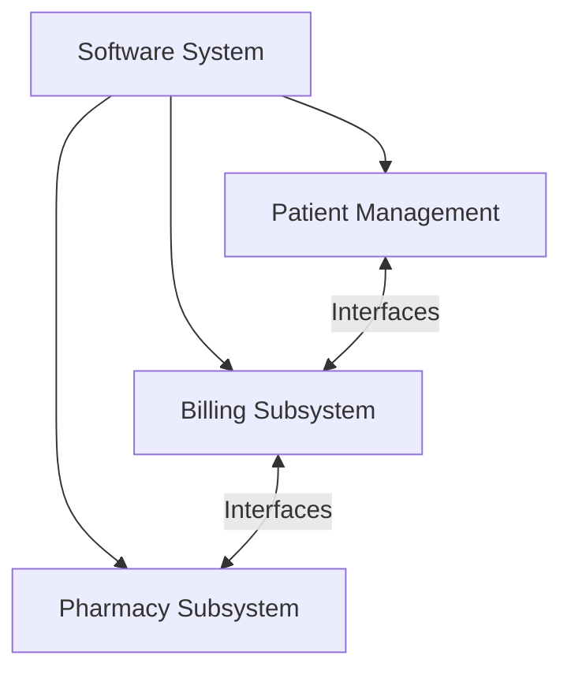

### 3. Allocation of Subsystems
Allocation assigns identified subsystems to suitable hardware or software components and determines where and how they execute.

Factors:
1. **Hardware Requirements:** Assign subsystems to suitable devices or processors.
2. **Performance:** Allocate performance-critical subsystems to adequate processing resources.
3. **Communication:** Consider communication requirements and reduce unnecessary communication.
4. **Concurrency:** Identify subsystems that can execute simultaneously.
5. **Resource Availability:** Consider memory, storage, processing power and network resources.
6. **Reliability:** Allocate critical subsystems to improve availability and fault tolerance.

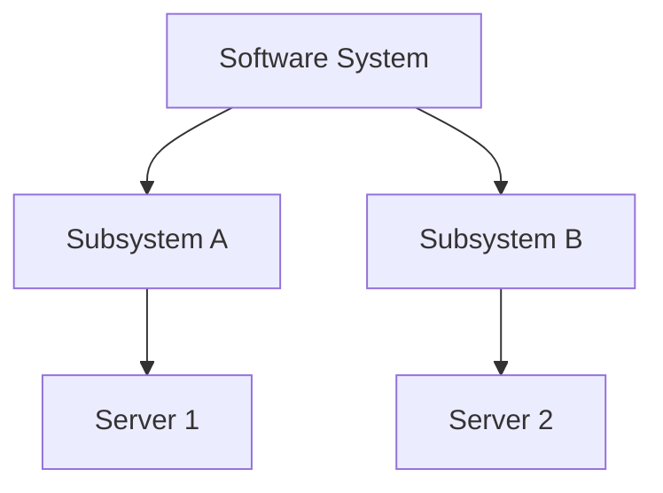

### 4. Advantages
- Reduces system complexity.
- Supports independent development and testing.
- Improves maintainability and reusability.
- Makes resource allocation easier.
- Supports parallel development and execution.

### 5. Conclusion
Breaking a system into subsystems divides a complex application into manageable functional units, whereas allocation assigns these units to suitable resources.

---

## Q9. Illustrate what a Subsystem is, along with the ways in which Subsystems can communicate.

**PYQ frequency:** 1/6 | **Marks:** 7 | **Priority:** Low

### 1. Definition
A **Subsystem** is a collection of related classes, objects and components that work together to perform a specific function within a larger system. Each subsystem has a defined responsibility and communicates through interfaces.

Example: Patient Management, Appointment Management, Billing and Pharmacy in a Hospital Management System.

### 2. Ways in Which Subsystems Communicate

**1. Procedure Calls**
- One subsystem directly calls an operation provided by another.
- The called subsystem performs the operation and may return a result.
- Suitable when an immediate response is required.
- Example: Appointment Subsystem calls Patient Management to retrieve patient details.

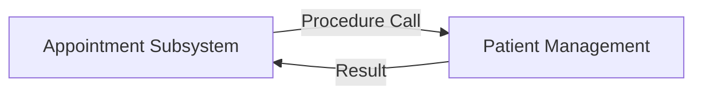

**2. Message Passing**
- Subsystems communicate by sending and receiving messages.
- A message contains information or a request for an operation.
- The receiving subsystem processes the message and responds when required.
- Example: Billing sends a payment-confirmation message to Patient Management.

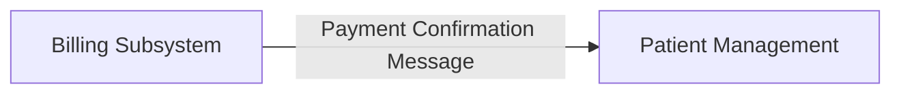

**3. Shared Data**
- Two or more subsystems communicate by accessing a common data store.
- One subsystem writes information while another reads or updates it.
- Synchronization and access control maintain consistency.
- Example: Patient Management and Billing access common patient records.

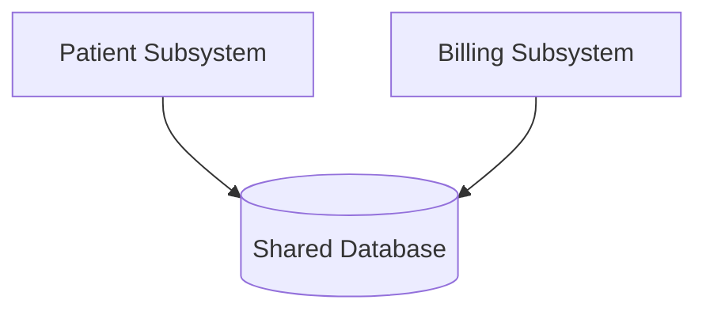

### 3. Advantages
- Enables cooperation between functional modules.
- Improves modularity and separation of responsibilities.
- Supports independent subsystem development.
- Improves flexibility and maintainability.
- Allows information sharing.

### 4. Conclusion
Subsystems communicate through procedure calls, message passing and shared data to coordinate the complete system.

---

## Q10. What do you mean by System Design? Illustrate with a suitable example.

**PYQ frequency:** 1/6 | **Marks:** 5 | **Priority:** Low

### 1. Definition
**System Design** is the process of defining the overall architecture, components, subsystems, interfaces and data organization of a software system. It converts the analysis model into a design model used for implementation.

### 2. Activities Involved
1. **Performance Estimation:** Estimates response time, throughput and resource requirements.
2. **Reuse Plan:** Identifies libraries, frameworks and design patterns that can be reused.
3. **Breaking into Subsystems:** Divides the system into smaller functional units.
4. **Identifying Concurrency:** Identifies activities or subsystems that can execute simultaneously.
5. **Allocation of Subsystems:** Assigns subsystems to suitable resources.
6. **Data Storage Management:** Determines how data is stored, organized and accessed.
7. **Global Resource Handling:** Defines how shared resources are managed.
8. **Software Control Strategy:** Determines how control flow is managed.
9. **Boundary Conditions:** Handles initialization, termination and abnormal conditions.
10. **Trade-off Priorities:** Balances performance, cost, reliability and maintainability.

### 3. Example: ATM System
An ATM can be divided into:
- **User Interface:** Interacts with customers through screen and keypad.
- **Authentication:** Verifies card and PIN.
- **Transaction:** Handles withdrawal, deposit and balance enquiry.
- **Bank Database:** Maintains account and transaction records.
- **Cash Dispenser:** Dispenses cash.

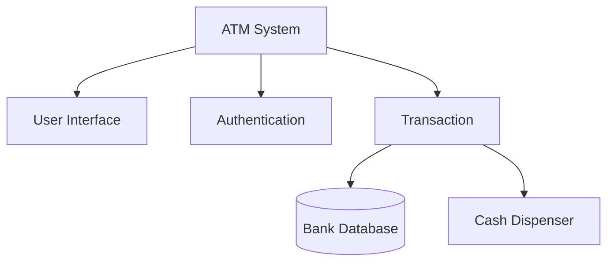

### 4. Conclusion
System Design transforms the analysis model into a structured software architecture and defines subsystems, communication, resource management and control strategies.

---

## Q11. Explain System Performance Estimation in System Design.

**PYQ frequency:** 1/6 | **Marks:** 5 | **Priority:** Low

### 1. Introduction
System Performance Estimation predicts how efficiently a software system will perform under expected operating conditions. It helps determine whether response time, throughput and resource-utilization requirements can be achieved.

### 2. Factors Considered
1. **Response Time:** Time required to respond to a user's request.
2. **Throughput:** Number of requests or transactions processed in a given period.
3. **Resource Utilization:** Usage of CPU, memory, storage and network bandwidth.
4. **Concurrency:** Number of users or processes that can execute simultaneously.
5. **Scalability:** Ability to handle increasing workloads.
6. **Bottleneck Identification:** Identifies a component that limits overall performance.

### 3. Steps Involved
1. Identify performance requirements.
2. Estimate expected users and transactions.
3. Identify critical operations and resource requirements.
4. Analyze response time and throughput.
5. Evaluate using prototypes, simulations or performance testing.
6. Optimize the design to remove bottlenecks.

### 4. Example: ATM System
Performance estimation considers PIN-authentication time, cash-withdrawal processing time, supported customers, database response time and cash-dispensing time.

### 5. Conclusion
System Performance Estimation predicts system efficiency and responsiveness before implementation and supports better architectural decisions.

---

## Q12. Explain in detail the components of a Component Diagram.

**PYQ frequency:** 2/6 | **Marks:** 6 | **Priority:** Medium

### 1. Introduction
A **Component Diagram** is a UML structural diagram that represents the organization of software components and their dependencies. It shows how components interact through interfaces.

### 2. Components

**1. Component**
- An independent and replaceable part of a software system.
- Encapsulates implementation and provides specific functionality.
- Example: Login, Payment and Database modules.

**2. Interface**
- Defines operations or services a component provides or requires.
- **Provided Interface (Lollipop):** Circle notation representing services provided.
- **Required Interface (Socket):** Semicircle notation representing services required.

**3. Dependency**
- Relationship in which one component depends on another.
- A change in the supplier may affect the dependent component.
- Represented by a dashed arrow pointing towards the supplier.
- Example: Payment Component depends on Authentication Component.

**4. Port**
- A specific interaction point through which a component communicates with its environment.
- Represented by a small square on the component boundary.

**5. Connector**
- Represents a communication link between components or their ports.
- Shows how components are connected and exchange information.

**6. Subsystem**
- A collection of related components working together to perform a particular function.
- Example: Patient Management and Billing subsystems in a hospital system.

### 3. Example: Online Shopping System

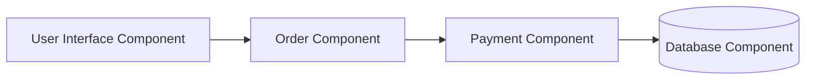

### 4. Advantages
- Represents structural organization.
- Shows dependencies.
- Supports modular development and reuse.
- Makes maintenance easier.
- Helps understand component interactions.

### 5. Conclusion
A Component Diagram represents software component organization and relationships. Components, interfaces, dependencies, ports and connectors help developers understand architecture and modularity.

---

## Q13. Explain the following with respect to Deployment Diagram: (i) Node (ii) Association (iii) Dependency.

**PYQ frequency:** 2/6 | **Marks:** 6 | **Priority:** Medium

### 1. Introduction
A **Deployment Diagram** is a UML structural diagram that represents the physical arrangement of hardware nodes and deployment of software components on those nodes.

### 2. Elements

**(i) Node**
- A physical or computational resource on which software components are deployed or executed.
- May represent a hardware device or software execution environment.
- Represented by a three-dimensional rectangular box.
- **Device Node:** Physical hardware such as a computer, server or mobile phone.
- **Execution Environment Node:** Software environment providing execution facilities, such as an operating system or application server.

```text
+----------------------+
|      Web Server      |
|   Web Application    |
+----------------------+
```

**(ii) Association**
- A communication connection between two or more nodes.
- Indicates that connected nodes can exchange information.
- Represented by a solid line.
- Example: A client computer communicates with a web server through a network.

```text
+----------------+       +----------------+
| Client Computer|-------| Web Server     |
+----------------+       +----------------+
```

**(iii) Dependency**
- A relationship in which one element depends on another.
- A change in the independent element may affect the dependent element.
- Represented by a dashed arrow pointing towards the supplier element.
- Example: A web application depends on a database service.

```text
+------------------+      - - - - - - >  +------------------+
| Web Application  |                     | Database Service |
+------------------+                     +------------------+
```

### 3. Example

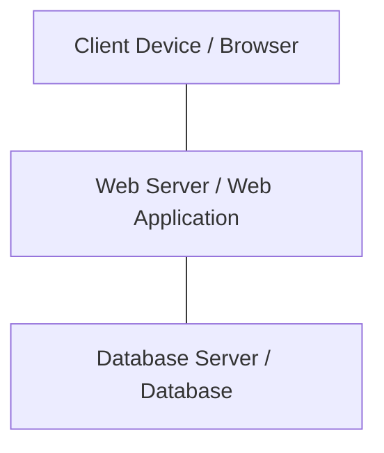

### 4. Conclusion
A Deployment Diagram represents physical architecture. A Node represents a computational resource, an Association represents communication between nodes and a Dependency represents dependence between model elements.

---

## Q14. Draw a Deployment Diagram for ATM System.

**PYQ frequency:** 2/6 | **Marks:** 5 | **Priority:** Medium

### 1. Introduction
A **Deployment Diagram** represents hardware nodes and deployed software components. An ATM system uses hardware and software components that communicate with the bank's central system.

### 2. Deployment Diagram for ATM System

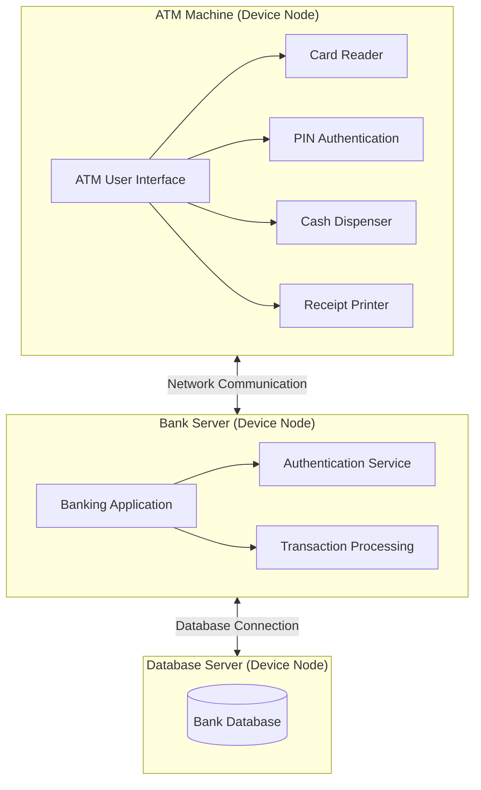

### 3. Explanation
1. **ATM Machine:** Physical device used by customers; contains card reader, keypad, display, cash dispenser and receipt printer.
2. **Bank Server:** Processes ATM requests, verifies customer credentials and manages transactions.
3. **Database Server:** Stores customer details, account information and transaction records.
4. **Network Connection:** Provides communication between ATM, bank server and database server.

### 4. Working
1. Customer inserts an ATM card.
2. ATM sends authentication details to the bank server.
3. Bank server verifies customer credentials.
4. Customer selects a transaction such as cash withdrawal.
5. Bank server checks account balance using the database.
6. If successful, ATM dispenses cash and prints a receipt.

### 5. Conclusion
The ATM Deployment Diagram illustrates the physical distribution of ATM hardware, bank server and database server communicating through a network.

---

## Q15. Explain the following: (i) Interactive Interface (ii) Dynamic Simulation (iii) Real-Time System (iv) Transaction Manager.

**PYQ frequency:** 2/6 | **Marks:** 7 | **Priority:** Medium

### (i) Interactive Interface
- Provides a medium through which users communicate with a software system.
- Allows users to enter data, give commands and receive responses.
- Acts as an interaction point between user and application.
- Should be user-friendly and responsive.
- Includes buttons, menus, forms and dialog boxes.
- **Example:** An ATM screen that allows selection of cash withdrawal and balance enquiry.

### (ii) Dynamic Simulation
- Represents and analyzes the dynamic behavior of a software system over time.
- Helps designers understand how objects and components behave when events occur.
- Tests system behavior without implementing the complete system.
- Helps identify design errors and performance issues.
- May be performed using simulation tools or executable models.
- **Example:** Simulating an ATM response to card insertion, PIN verification and cash withdrawal.

### (iii) Real-Time System
- Processes inputs and produces outputs within a specified time limit.
- Correctness depends on both logical result and the time at which it is produced.
- Monitors events and responds within defined deadlines.

**Types:**
1. **Hard Real-Time System:** Missing a deadline is considered a system failure.
2. **Soft Real-Time System:** Missing a deadline occasionally is acceptable, but may reduce performance.

Examples: Airbag control systems, traffic control systems and industrial monitoring systems.

### (iv) Transaction Manager
- A software component responsible for controlling and coordinating transactions.
- Ensures transactions execute correctly and database consistency is maintained.
- Manages transaction execution, commit and rollback.
- Handles failures and prevents incomplete transactions from leaving the database inconsistent.
- Commonly supports ACID properties: Atomicity, Consistency, Isolation and Durability.
- **Example:** During an ATM withdrawal, it coordinates balance deduction and transaction recording. If the operation fails, appropriate rollback or recovery is performed.

### Conclusion
Interactive Interface enables user interaction, Dynamic Simulation analyzes system behavior, Real-Time Systems provide responses within deadlines, and Transaction Managers ensure reliable transaction processing.

---

## Q16. Explain the Architecture of ATM System with a suitable diagram.

**PYQ frequency:** 3/6 | **Marks:** 5–7 | **Priority:** High

### 1. Introduction
An **Automated Teller Machine (ATM)** is an electronic banking system that allows customers to perform financial transactions without visiting a bank branch. ATM architecture describes the organization of hardware and software components, their responsibilities and communication with the bank's central system.

### 2. Components of ATM Architecture

**1. User Interface**
- Provides interaction through display screen, keypad and function buttons.
- Accepts customer inputs and displays transaction information.

**2. Card Reader**
- Reads information stored on the ATM or debit card.
- Sends card details for authentication.

**3. Authentication System**
- Verifies the customer's card and PIN.
- Communicates with the bank server to validate credentials.

**4. Transaction Processing System**
- Processes withdrawal, deposit and balance-enquiry requests.
- Checks account details and transaction limits.
- Communicates with the bank database.

**5. Cash Dispenser**
- Dispenses the requested amount after successful authorization.
- Checks cash availability before dispensing.

**6. Receipt Printer**
- Prints transaction amount, date and other transaction details.

**7. Bank Server and Database**
- Bank server processes ATM requests and manages transactions.
- Database stores customer information, account details and transaction records.

### 3. ATM Architecture Diagram

```mermaid
flowchart TB
 C[Customer] --> UI[ATM User Interface]
 UI --> CR[Card Reader]
 UI --> PIN[PIN Authentication]
 PIN --> BS[Bank Server]
 BS --> AUTH[Authentication Service]
 AUTH --> DB[(Bank Database)]
 BS --> TP[Transaction Processing]
 TP --> DB
 TP --> CD[Cash Dispenser]
 TP --> RP[Receipt Printer]
 CD --> C
 RP --> C
```

### 4. Working of ATM System
1. Customer inserts the ATM card into the card reader.
2. ATM reads card details and asks the customer to enter the PIN.
3. Authentication system sends the required details to the bank server.
4. After successful authentication, the customer selects a transaction.
5. Transaction processing verifies account balance and transaction details.
6. If successful, the cash dispenser dispenses cash when required.
7. Receipt printer generates a transaction receipt.

### 5. Advantages
- Provides banking services 24 hours a day.
- Reduces workload at bank branches.
- Supports fast and convenient transactions.
- Provides authentication and transaction processing.
- Improves banking service availability.

### 6. Conclusion
ATM architecture consists of user-interface devices, authentication services, transaction-processing components, cash dispensers and bank servers. These components work together to provide secure and convenient banking services.
