# Unit V – Class Design, Implementation Modeling and Legacy Systems

**Subject:** Object Oriented Modeling and Design (410244(D))  
**Course:** Fourth Year Computer Engineering – SPPU, 2019 Course

These answers preserve the questions and marks supplied during preparation. Answers are structured for SPPU end-semester writing, with concise explanations and reproducible UML or process diagrams where useful.

---

## Q1. Give detailed guidelines for finding and defining classes involved in a software system scenario.

**Marks: 6 | Difficulty: Medium**

### 1. Introduction
Class identification is an important activity in object-oriented analysis and design. It involves identifying important classes in a software scenario and defining their attributes, operations and relationships. A well-defined class model represents the static structure of the system.

### 2. Guidelines for Finding and Defining Classes

1. **Study the system requirements:** Understand the problem statement, requirements and use cases. Identify important objects and concepts.
2. **Identify candidate classes:** Examine important nouns and noun phrases in the problem description. They may represent classes, such as Customer, Account, Employee, Book and Transaction. Consider both real-world and conceptual entities.
3. **Eliminate unnecessary classes:** Remove duplicate, irrelevant or unnecessary candidates. Avoid creating classes for simple attributes or implementation details.
4. **Define class attributes:** Identify the data that describes each class and assign suitable names and data types. For example, Student may have studentId, name and address.
5. **Identify class operations:** Determine the responsibilities and behaviour of each class from the required actions. For example, BankAccount may provide deposit(), withdraw() and checkBalance().
6. **Identify relationships:** Determine how classes are related. Consider association, aggregation, composition and inheritance, and specify multiplicity where required.
7. **Ensure high cohesion and low coupling:** Give each class a focused responsibility and avoid unnecessary dependencies.
8. **Review and refine the model:** Check that requirements are represented, remove unnecessary complexity and ensure consistency.

### 3. Example: Library Management System

| Class | Attributes | Operations |
|---|---|---|
| Book | bookId, title, author | searchBook(), updateBook() |
| Member | memberId, name, address | registerMember(), borrowBook() |
| Librarian | librarianId, name | issueBook(), returnBook() |
| Transaction | transactionId, issueDate, returnDate | calculateFine() |

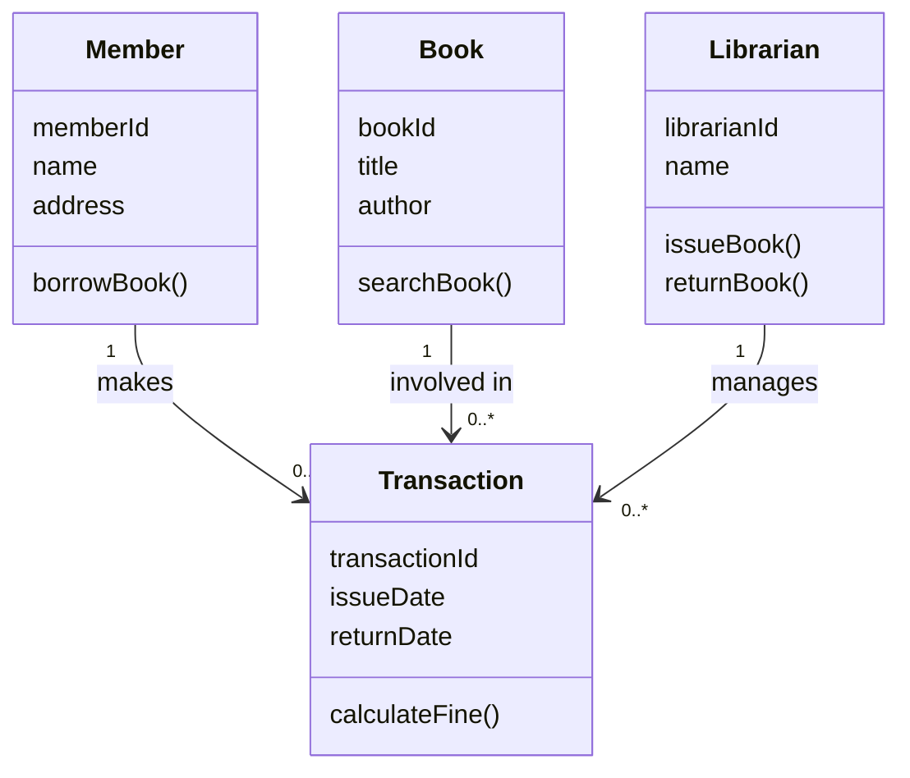

### 4. Conclusion
Finding and defining classes requires understanding requirements, identifying relevant objects, defining attributes and operations, and establishing relationships. These guidelines help create a clear, reusable and maintainable object-oriented system.

---

## Q2. Discuss the steps involved in constructing an Application Class Model. Explain with a suitable example.

**Marks: 6 | Difficulty: Low**

### 1. Introduction
An **Application Class Model** represents the static structure of an application. It identifies the classes required to implement the application, along with their attributes, operations and relationships. It is constructed during application analysis by studying requirements and refining the initial class model.

### 2. Steps Involved

1. **Identify candidate classes:** Study application requirements and use cases. Identify important objects and concepts that can be represented as classes.
2. **Eliminate unnecessary classes:** Remove duplicate, irrelevant and unnecessary classes. Retain classes that contribute to application functionality.
3. **Identify attributes:** Determine the data required to describe each class and assign suitable names and data types.
4. **Identify relationships:** Determine associations, aggregation, composition and inheritance. Define multiplicity wherever necessary.
5. **Identify operations:** Examine use cases and identify the responsibilities and operations of each class.
6. **Refine and validate:** Review the model against requirements, check consistency and remove unnecessary complexity.

### 3. Example: Library Management System

| Class | Attributes | Operations |
|---|---|---|
| Book | bookId, title, author | searchBook(), updateBook() |
| Member | memberId, name | borrowBook(), returnBook() |
| Librarian | librarianId, name | issueBook(), manageBook() |
| Transaction | transactionId, issueDate, returnDate | calculateFine() |

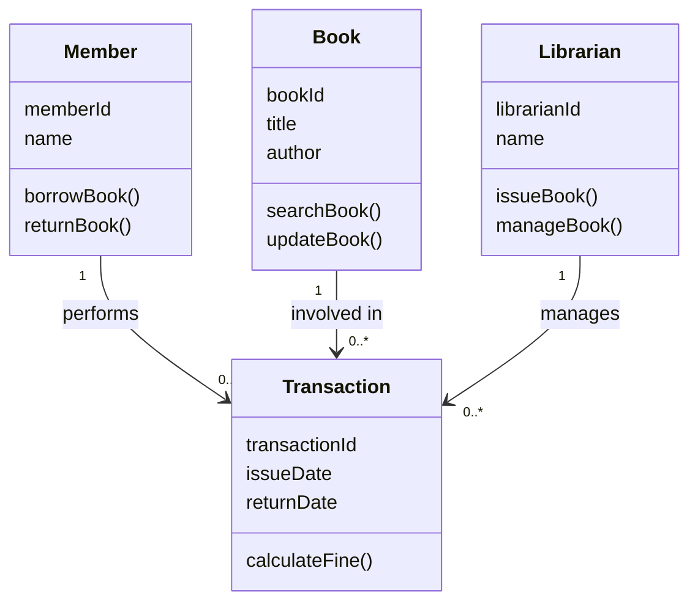

### 4. Conclusion
Constructing an Application Class Model involves identifying candidate classes, removing unnecessary classes, defining attributes and operations, establishing relationships and validating the model. It provides a clear representation of the application's structure for further design and implementation.

---

## Q3. What is a Scenario? Explain the purpose of defining a Scenario with a suitable example.

**Marks: 7 | Difficulty: Medium**

### 1. Definition
A **Scenario** is a sequence of steps that describes a particular interaction between an actor and a system to achieve a specific goal. It represents one possible path through a use case and explains how the system responds to user actions and events.

### 2. Purpose of Defining a Scenario

1. **Understanding system behaviour:** Shows how users interact with the system in a particular situation.
2. **Requirement identification:** Helps identify functional requirements and expected system responses.
3. **Identifying objects and classes:** Helps identify objects, classes and responsibilities required in the system.
4. **Identifying interactions:** Describes the sequence of communication between actors and system objects.
5. **Handling alternative conditions:** Helps identify alternative flows, exceptional situations and error conditions.
6. **Supporting system design:** Provides a foundation for use case, sequence and activity diagrams.
7. **Testing and validation:** Helps prepare test cases to verify expected system behaviour.

### 3. Example: ATM Cash Withdrawal Scenario

**Actors:** Customer and Bank System  
**Precondition:** The customer has a valid ATM card and an active bank account.

**Main Scenario:**
1. Customer inserts the ATM card.
2. ATM asks the customer to enter the PIN.
3. Customer enters the PIN.
4. ATM verifies the PIN with the bank system.
5. ATM displays available banking options.
6. Customer selects cash withdrawal.
7. ATM asks for the withdrawal amount.
8. Customer enters the amount.
9. Bank system checks the account balance.
10. If sufficient balance is available, the bank approves the transaction.
11. ATM dispenses cash.
12. ATM updates the account balance and returns the card.

**Alternative Scenario:**
- If the PIN is incorrect, ATM displays an error message.
- If the account has insufficient balance, ATM rejects the transaction.
- If cash is unavailable, the transaction is cancelled.

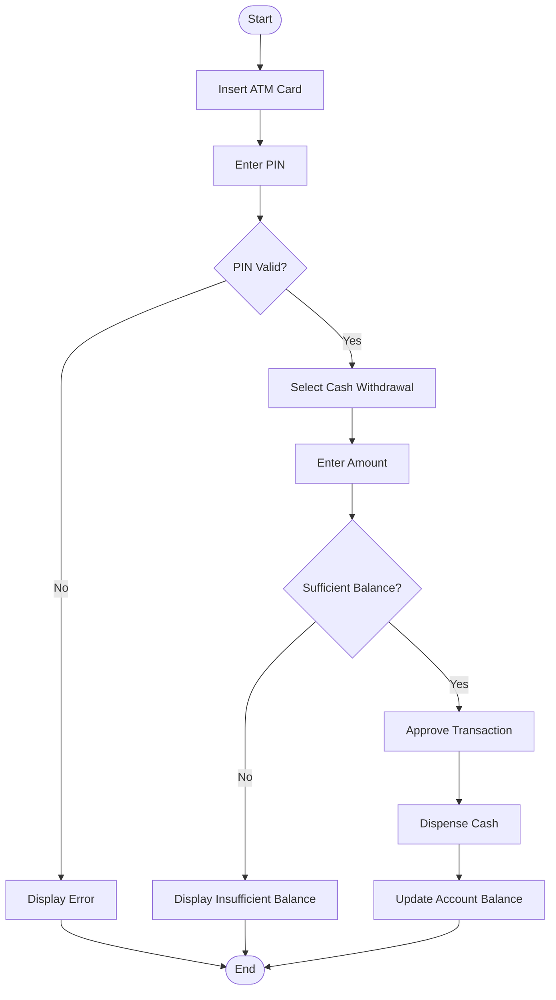

### 4. Conclusion
A scenario describes a specific sequence of interactions between an actor and a system to achieve a goal. It helps understand requirements, identify objects, design interactions, handle exceptional conditions and prepare test cases.

---

## Q4. Prepare a Data Dictionary for an ATM System scenario. Explain each element briefly.

**Marks: 7 | Difficulty: Medium**

### 1. Definition
A **Data Dictionary** is a collection of information describing the data elements used in a software system. It records details such as data names, types, descriptions, formats and constraints.

### 2. Data Dictionary for ATM System

| Data Element | Data Type | Description |
|---|---|---|
| Card_Number | String | Unique number identifying the ATM card |
| PIN | Integer/String | Secret identification value used to authenticate the customer |
| Account_Number | String | Unique number assigned to the bank account |
| Customer_Name | String | Name of the account holder |
| Account_Balance | Decimal | Available balance in the account |
| Transaction_ID | String | Unique identifier assigned to a transaction |
| Transaction_Type | String | Type of transaction, such as withdrawal or balance enquiry |
| Transaction_Amount | Decimal | Amount involved in the transaction |
| Transaction_Date | Date/Time | Date and time of the transaction |
| ATM_ID | String | Unique identification number of the ATM |
| Cash_Available | Decimal | Cash currently available in the ATM |
| Receipt_Status | Boolean | Indicates whether a receipt was generated |

### 3. Explanation of Important Elements

1. **Card Number:** Identifies the ATM card used by the customer.
2. **PIN:** Verifies the customer's identity before transactions are allowed.
3. **Account Number:** Identifies the bank account associated with the card.
4. **Account Balance:** Stores the available amount in the customer's account.
5. **Transaction ID:** Uniquely identifies and tracks each transaction.
6. **Transaction Type:** Specifies the operation performed by the customer.
7. **Transaction Amount:** Represents the amount deposited, withdrawn or transferred.
8. **ATM ID:** Identifies the ATM processing the transaction.
9. **Cash Available:** Helps determine whether sufficient cash is available for withdrawal.
10. **Receipt Status:** Indicates whether a transaction receipt has been generated.

### 4. Conclusion
A Data Dictionary provides an organized description of the data elements used in an ATM System. It maintains consistency, improves communication and supports system design, implementation and maintenance.

---

## Q5. Write a short note on Data Dictionary.

**Marks: 5 | Difficulty: Medium**

### 1. Definition
A **Data Dictionary** is a centralized collection of information about the data elements used in a software system. It describes the meaning, structure, type, format and constraints of data. It acts as a reference for developers, designers and database administrators.

### 2. Contents of a Data Dictionary

1. **Data Name:** Unique name used to identify a data element.
2. **Data Description:** Explains the meaning and purpose of the element.
3. **Data Type:** Specifies the type, such as Integer, String, Float or Date.
4. **Data Size:** Defines the maximum length or storage size.
5. **Default Value:** Specifies the value assigned when no value is provided.
6. **Constraints:** Defines rules such as NOT NULL, UNIQUE and PRIMARY KEY.
7. **Relationships:** Describes associations between data elements or entities.

### 3. Example: ATM System

| Data Element | Data Type | Description |
|---|---|---|
| Card_Number | String | Unique ATM card number |
| PIN | String | Customer authentication PIN |
| Account_Number | String | Unique bank account number |
| Account_Balance | Decimal | Available account balance |
| Transaction_ID | String | Unique transaction identifier |
| Transaction_Amount | Decimal | Amount involved in a transaction |

### 4. Advantages

1. **Consistency:** Maintains uniform data definitions throughout the system.
2. **Better communication:** Helps developers understand data structures.
3. **Easy maintenance:** Makes modifications and updates easier.
4. **Reduced redundancy:** Helps identify duplicate data definitions.
5. **Documentation:** Provides a centralized reference for system data.

### 5. Conclusion
A Data Dictionary is an important documentation component in software development. It describes data elements and helps maintain consistency, accuracy and understanding throughout system design and implementation.

---

## Q6. List and explain different types of Dependencies in a Package.

**Marks: 6 | Difficulty: Medium**

### 1. Introduction
A **Package** in UML groups related model elements such as classes, interfaces and other packages. It helps organize a large software system into manageable modules.

A **Package Dependency** represents a relationship in which changes in one package may affect another package. It is generally represented by a dashed arrow from the dependent package (client) towards the supplier package.

### 2. Types of Package Dependencies

1. **Usage Dependency (`<<use>>`):**
   - Indicates that one package requires services or elements provided by another package.
   - Changes in the supplier package may affect the client package.

2. **Import Dependency (`<<import>>`):**
   - Indicates that a package imports the public members of another package into its own namespace.
   - Imported elements can be referred to without qualifying them with the supplier package name.

3. **Access Dependency (`<<access>>`):**
   - Indicates that one package can access the public members of another package.
   - The accessed members are not added to the namespace of the accessing package.

4. **Merge Dependency (`<<merge>>`):**
   - Indicates that the contents or definitions of one package are combined with another package.
   - The receiving package incorporates or extends the features of the merged package.

### 3. Conceptual UML Representation

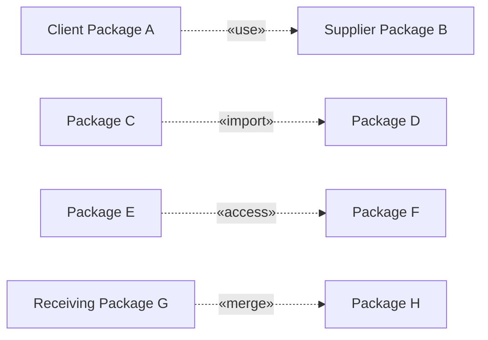

*The diagram illustrates dependency direction and stereotypes conceptually. In UML, package dependencies are drawn as dashed dependency arrows.*

### 4. Advantages

- **Modularity:** Divides a large system into manageable packages.
- **Reusability:** Allows packages to use services provided by other packages.
- **Maintainability:** Helps identify the impact of changes.
- **Organization:** Improves the structure and readability of models.

### 5. Conclusion
Package dependencies define how packages are related. Usage, Import, Access and Merge dependencies help organize software components, improve modularity and simplify maintenance.

---

## Q7. What is Abstraction? Explain the different categories of Abstraction.

**Marks: 6 | Difficulty: Low**

### 1. Definition
**Abstraction** is an object-oriented design concept that focuses on the essential features of an object while hiding unnecessary implementation details. It reduces system complexity by showing relevant information and hiding internal working details.

For example, an ATM user can withdraw cash without knowing the internal processing performed by the banking system.

### 2. Categories of Abstraction

1. **Entity Abstraction:**
   - Represents real-world objects or entities in a software system.
   - Describes their important properties and behaviour.
   - Examples: Student, Employee, Customer and Bank Account.

2. **Action Abstraction:**
   - Represents an operation or activity performed by an object.
   - Focuses on what an operation does rather than how it is implemented.
   - Examples: withdrawMoney(), calculateSalary() and issueBook().

3. **Virtual Machine Abstraction:**
   - Provides a higher-level interface that hides the complexity of lower-level operations.
   - Allows users or programs to interact with a system without knowing its internal implementation.
   - Example: An operating system provides file operations without requiring users to understand disk hardware operations.

4. **Coincidental Abstraction:**
   - Groups unrelated elements together without a meaningful relationship.
   - Does not represent a clear concept or responsibility and is generally undesirable in good object-oriented design.

### 3. Advantages

- Reduces software complexity.
- Hides unnecessary implementation details.
- Improves reusability and maintainability.
- Separates interface from implementation.
- Makes software easier to understand and modify.

### 4. Conclusion
Abstraction focuses on essential features while hiding unnecessary details. Entity, Action, Virtual Machine and Coincidental abstractions are its categories. Proper abstraction helps develop simple, modular and maintainable software.

---

## Q8. Explain the tasks involved in Design Optimization.

**Marks: 5 | Difficulty: Medium**

### 1. Introduction
**Design Optimization** is the process of improving an object-oriented design to achieve better performance, maintainability, reusability and efficiency without changing the external behaviour of the system.

### 2. Tasks Involved in Design Optimization

1. **Improve Data Access:** Optimize the way objects access and store data. Reduce unnecessary retrieval and improve access efficiency.
2. **Improve Algorithm Efficiency:** Select efficient algorithms for operations to reduce execution time and unnecessary computation.
3. **Reduce Redundant Computations:** Avoid repeated calculations and reuse previously calculated results where appropriate.
4. **Optimize Storage:** Remove unnecessary attributes and redundant data. Use memory and storage resources efficiently.
5. **Optimize Class Relationships:** Reduce unnecessary dependencies, improve cohesion and reduce coupling. Simplify inheritance and associations where appropriate.
6. **Improve Overall Performance:** Identify bottlenecks and optimize frequently executed operations and critical components.

### 3. Advantages

- Improves execution speed.
- Reduces memory and storage requirements.
- Increases maintainability and reusability.
- Reduces unnecessary complexity.
- Improves overall software quality.

### 4. Conclusion
Design Optimization improves system efficiency by optimizing data access, algorithms, computations, storage and class relationships. It helps develop high-performance and maintainable software.

---

## Q9. Explain the steps involved in designing algorithms.

**Marks: 5 | Difficulty: Low**

### 1. Introduction
**Algorithm Design** is the process of developing a step-by-step procedure to perform the operations required by a class or object. In object-oriented design, algorithms implement class operations while ensuring correctness and efficiency.

### 2. Steps Involved

1. **Identify the Operation:** Determine the operation to be implemented and understand its purpose and expected behaviour.
2. **Determine Inputs and Outputs:** Identify input parameters and specify the expected result.
3. **Define the Logic:** Develop step-by-step logic and identify conditions, calculations and processing steps.
4. **Choose Suitable Data Structures:** Select appropriate structures such as arrays, lists, stacks, queues or trees.
5. **Optimize the Algorithm:** Reduce unnecessary operations and improve execution time and memory utilization.
6. **Verify and Test:** Check correctness with different test cases and handle exceptional and boundary conditions.

### 3. Example: ATM Cash Withdrawal Algorithm

```text
Algorithm: WithdrawCash

1. Start
2. Accept account number and withdrawal amount.
3. Verify the customer account.
4. Check whether the account has sufficient balance.
5. If balance is sufficient:
      Deduct the withdrawal amount.
      Dispense cash.
      Display successful transaction.
6. Otherwise:
      Display insufficient balance message.
7. Stop
```

### 4. Conclusion
Algorithm design involves identifying operations, determining inputs and outputs, developing logic, selecting data structures, optimizing and testing the solution. These steps help produce correct and efficient software operations.

---

## Q10. Explain the steps involved in Class Design. How do you bridge the gap from high-level requirements to low-level services?

**Marks: 5 | Difficulty: Low**

### 1. Introduction
**Class Design** transforms the analysis model into a detailed design model that can be implemented using an object-oriented programming language. It defines classes, attributes, operations, relationships and internal behaviour.

### 2. Steps Involved in Class Design

1. **Bridging the Gap:** Transform high-level requirements and analysis classes into detailed design classes. Identify services needed to implement system functionality.
2. **Realizing Use Cases:** Identify classes participating in each use case and define how objects communicate to perform the required functionality.
3. **Designing Algorithms:** Develop algorithms for class operations and select suitable data structures.
4. **Recursing Downwards:** Break complex operations into smaller operations until they can be implemented directly.
5. **Refactoring:** Improve the internal structure of classes without changing external behaviour. Remove duplication and improve organization.
6. **Design Optimization:** Improve performance, memory utilization and efficiency.
7. **Organizing Class Design:** Arrange classes into suitable packages and subsystems and define proper relationships.

### 3. Bridging High-Level Requirements to Low-Level Services

Bridging the gap means converting abstract system requirements into detailed class-level operations and services.

1. Understand high-level requirements and use cases.
2. Identify candidate classes and their responsibilities.
3. Define attributes and operations for each class.
4. Establish relationships and communication between classes.
5. Decompose complex operations into smaller services.
6. Specify algorithms and implementation details for each service.

**Example: ATM Cash Withdrawal**

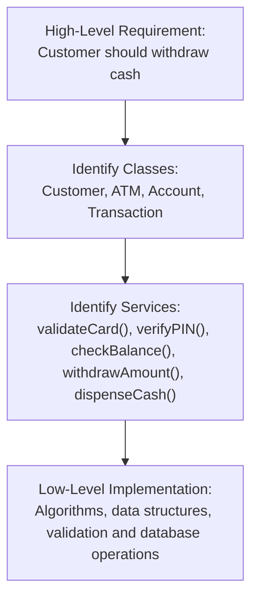

### 4. Conclusion
Class Design transforms the analysis model into an implementable design through use-case realization, algorithm design, refactoring and optimization. Bridging the gap converts high-level requirements into well-defined low-level services.

---

## Q11. How is Adjustment of Inheritance done in Class Design? Explain its importance and steps.

**Marks: 5–7 | Difficulty: Medium**

### 1. Introduction
**Adjustment of Inheritance** is the process of modifying and refining the inheritance hierarchy during class design to achieve better code reuse, flexibility and maintainability. It involves reviewing superclass and subclass relationships and ensuring that common features are placed in appropriate classes.

### 2. Importance

1. **Code Reusability:** Common attributes and operations can be defined in a superclass and reused by subclasses.
2. **Reduction of Duplication:** Avoids repeating the same code in multiple classes.
3. **Improved Maintainability:** Common features can be modified at the superclass level.
4. **Better Class Organization:** Creates a logical inheritance hierarchy.
5. **Improved Flexibility:** Makes it easier to extend the system with new subclasses.

### 3. Steps Involved

1. **Identify Common Features:** Examine classes and identify common attributes and operations.
2. **Create or Modify Superclasses:** Move common features into a suitable superclass.
3. **Move Features Between Classes:** Place attributes and operations in the class where they are most meaningful.
4. **Eliminate Unnecessary Inheritance:** Remove relationships that do not represent a genuine *is-a* relationship.
5. **Verify Relationships:** Check whether subclasses correctly inherit superclass properties and behaviour.
6. **Refine and Test:** Review the modified hierarchy and ensure existing functionality is not affected.

### 4. Example

In a banking system, SavingsAccount and CurrentAccount may share accountNumber, balance, deposit() and withdraw(). These common features can be placed in a superclass named BankAccount.

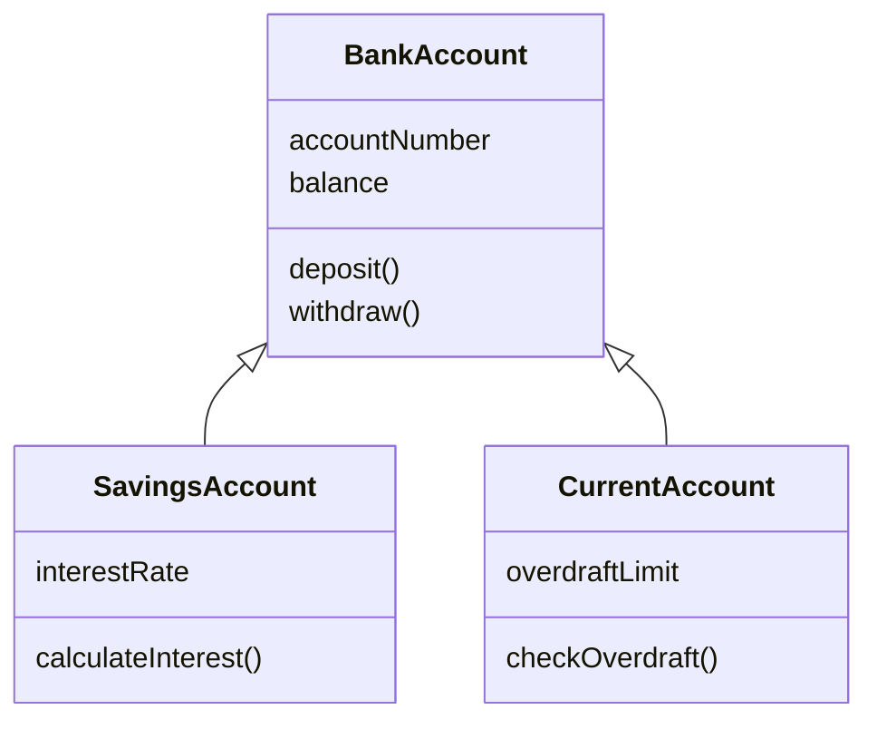

### 5. Conclusion
Adjustment of Inheritance improves the class hierarchy by identifying common features, refining superclass and subclass relationships and eliminating unnecessary inheritance. It promotes reuse, reduces duplication and makes software easier to maintain and extend.

---

## Q12. Draw a Class Model by using Fine-tuning Generalization and Realizing Associations.

**Marks: 5 | Difficulty: Low**

### 1. Introduction
During implementation modeling, the initial class model is refined to make it suitable for software implementation. Two important activities are Fine-tuning Generalization and Realizing Associations.

### 2. Fine-tuning Generalization

Fine-tuning generalization involves refining inheritance relationships between classes.

- Identify common attributes and operations among classes.
- Move common features into a suitable superclass.
- Keep specialized features in their respective subclasses.
- Remove unnecessary or incorrect inheritance relationships.
- Ensure inheritance represents a meaningful *is-a* relationship.

### 3. Realizing Associations

Realizing associations means implementing relationships between classes using object references, attributes or collections.

- Identify associations between classes.
- Determine multiplicity.
- Implement one-to-one relationships using object references.
- Implement one-to-many relationships using collections.
- Maintain referential integrity and consistency.

### 4. Class Model Example

Consider a Banking System containing different types of accounts and customers.

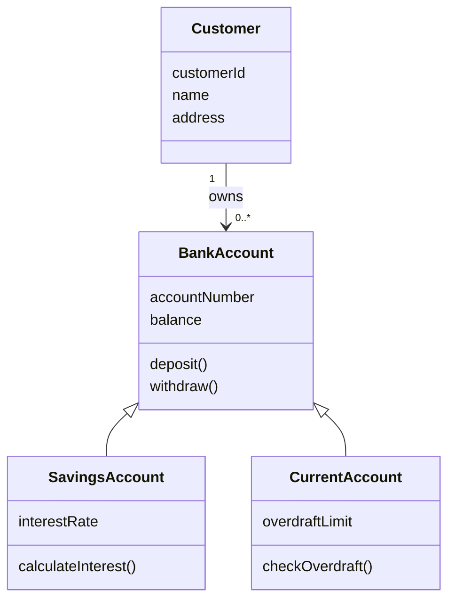

**Explanation:**
- BankAccount is the superclass containing common attributes and operations.
- SavingsAccount and CurrentAccount inherit common features.
- Customer is associated with BankAccount.
- One customer can own multiple accounts, while each account belongs to one customer in this example.

### 5. Conclusion
Fine-tuning generalization improves inheritance relationships by organizing common and specialized features. Realizing associations converts relationships into implementable references and collections. Both activities help transform a conceptual class model into an implementation-ready design.

---

## Q13. Write short notes on: (i) Steps involved in Organizing Class Design (ii) Refactoring.

**Marks: 6 | Difficulty: Low**

### (i) Steps Involved in Organizing Class Design

**Definition:** Organizing Class Design is the process of arranging classes into a proper structure so that the software system becomes modular, understandable and easy to maintain.

**Steps:**

1. **Identify Classes:** Identify classes required to implement the system and determine their responsibilities.
2. **Group Related Classes:** Group logically related classes into suitable packages.
3. **Define Class Relationships:** Identify inheritance, association, aggregation and composition relationships.
4. **Assign Responsibilities:** Give each class a clear and specific responsibility.
5. **Reduce Dependencies:** Minimize unnecessary dependencies and maintain high cohesion and low coupling.
6. **Review the Design:** Verify that the organization satisfies requirements and remove unnecessary classes and relationships.

**Advantages:**
- Improves code organization.
- Makes the system easier to understand.
- Supports reusability and maintainability.
- Simplifies future modifications.

### (ii) Refactoring

**Definition:** **Refactoring** is the process of improving the internal structure of existing software without changing its external behaviour or functionality. It makes code cleaner, simpler and easier to maintain.

**Techniques:**

1. **Extract Method:** Divide a large method into smaller methods.
2. **Move Method:** Move a method to the class where it logically belongs.
3. **Rename Method or Variable:** Use meaningful names to improve readability.
4. **Remove Duplicate Code:** Eliminate repeated code by creating reusable methods.
5. **Encapsulate Fields:** Restrict direct access to data using suitable methods.
6. **Extract Class:** Divide a large class into smaller classes with separate responsibilities.

**Advantages:**
- Improves readability.
- Reduces code duplication.
- Improves maintainability and reusability.
- Makes future development easier.
- Reduces software complexity.

### 4. Conclusion
Organizing Class Design arranges classes and relationships into a structured system, whereas Refactoring improves the internal code structure without changing external behaviour. Both help develop modular and maintainable software.

---

## Q14. Explain Refactoring and Reification in relation to Class Design.

**Marks: 7 | Difficulty: Low**

### 1. Refactoring

**Definition:** Refactoring is the process of improving the internal structure of existing software without changing its external behaviour or functionality. It is performed during class design to make classes simpler, reusable and maintainable.

**Techniques:**

1. **Extract Method:** Divide a large method into smaller methods.
2. **Move Method:** Move a method to the class where it logically belongs.
3. **Extract Class:** Divide a large class into smaller classes with separate responsibilities.
4. **Remove Duplicate Code:** Eliminate repeated code by creating reusable methods.
5. **Rename Variables and Methods:** Use meaningful names to improve code clarity.
6. **Encapsulate Fields:** Restrict direct access to attributes using suitable methods.

**Advantages:**
- Improves code readability and structure.
- Reduces duplication.
- Increases maintainability and reusability.
- Reduces software complexity.
- Makes future modifications easier.

### 2. Reification

**Definition:** **Reification** is the process of converting an abstract concept, behaviour or relationship into an explicit class or object in software design. It is useful when behaviour or a relationship becomes sufficiently complex and needs to be represented separately.

**Steps Involved:**

1. **Identify Complex Behaviour:** Identify behaviour that cannot be represented easily using simple operations.
2. **Create a Separate Class:** Convert the complex behaviour into a separate class.
3. **Define Attributes:** Identify data required to represent the behaviour.
4. **Define Operations:** Specify operations responsible for performing the behaviour.
5. **Establish Relationships:** Connect the new class with other relevant classes.

**Example:** In a banking system, transferring money may initially be represented as an operation. If the transfer requires transaction ID, date, amount and status, it can be represented using a separate Transaction class.

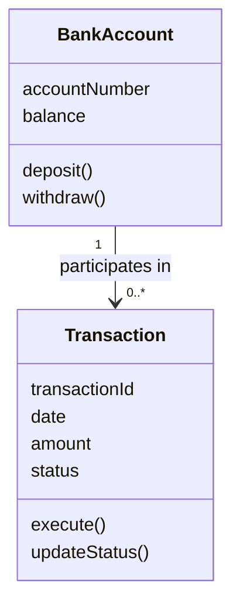

### 3. Difference Between Refactoring and Reification

| Refactoring | Reification |
|---|---|
| Improves the internal structure of an existing design. | Converts abstract behaviour or concepts into explicit classes or objects. |
| Does not change external behaviour. | Introduces a new representation in the design. |
| Focuses on improving existing classes and methods. | Focuses on representing complex concepts separately. |
| Reduces duplication and complexity. | Makes complex behaviour easier to manage. |
| Example: Extracting a method. | Example: Creating a Transaction class. |

### 4. Conclusion
Refactoring improves the internal structure of existing classes, whereas Reification converts complex behaviour or abstract concepts into explicit classes. Both help create modular, understandable and maintainable object-oriented software.

---

## Q15. Explain the steps involved in Implementation Modeling.

**Marks: 5 | Difficulty: Low**

### 1. Introduction
**Implementation Modeling** is the process of converting the design model into a form suitable for actual software implementation. It focuses on refining classes, inheritance relationships and associations.

### 2. Steps Involved

1. **Fine-tuning Classes:** Refine class definitions for implementation. Define attributes, methods, data types and visibility, and remove unnecessary elements.
2. **Fine-tuning Generalizations:** Refine inheritance relationships. Move common attributes and operations into the superclass and ensure inheritance is meaningful.
3. **Realizing Associations:** Convert associations into implementable structures. Use object references, pointers or collections and define appropriate multiplicity and navigation.
4. **Testing:** Test individual classes, operations, relationships and object interactions. Identify and correct errors to ensure that implementation satisfies requirements.

### 3. Implementation Modeling Flow

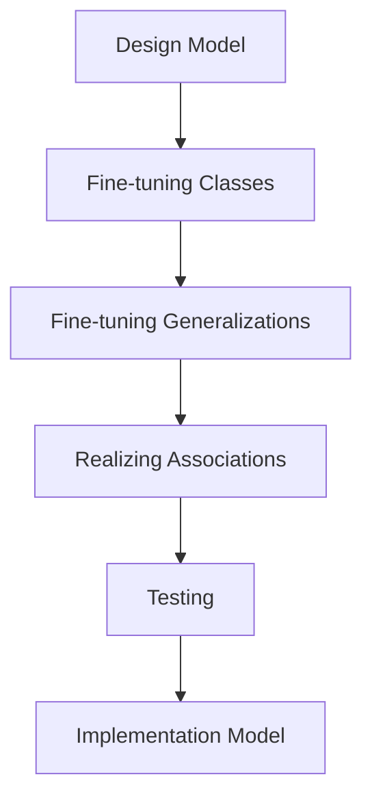

### 4. Advantages

- Converts design into an implementation-ready structure.
- Improves class organization and consistency.
- Ensures proper inheritance and associations.
- Helps identify errors before final implementation.
- Improves maintainability and reliability.

### 5. Conclusion
Implementation Modeling involves fine-tuning classes, refining generalizations, realizing associations and testing. These steps transform the design model into a structure suitable for software implementation.

---

## Q16. Define Reverse Engineering. What are the inputs provided to Reverse Engineering and what are its outputs?

**Marks: 7 | Difficulty: Low**

### 1. Definition
**Reverse Engineering** is the process of analysing an existing software system to identify its components, structure, design and functionality. It studies source code, executable programs and other system information to recover the design and documentation of software.

It is useful when original design documents are unavailable or outdated.

### 2. Inputs to Reverse Engineering

1. **Source Code:** Existing program code written in languages such as Java, C++ or Python. It helps identify classes, methods and relationships.
2. **Executable Programs:** Compiled software or executable files used to understand system behaviour.
3. **Existing Documentation:** Available design documents, user manuals and technical specifications.
4. **Database Structure:** Existing database schemas, tables and relationships that explain data organization.
5. **System Behaviour:** Input-output information and execution behaviour that help identify actual functionality.

### 3. Outputs of Reverse Engineering

1. **Class Model:** Represents classes, attributes, operations and relationships.
2. **Interaction Model:** Represents communication and interactions between objects.
3. **State Model:** Represents object states and transitions.
4. **Recovered Design Documentation:** Provides recovered design information and system structure.
5. **System Understanding:** Helps developers understand internal working and architecture.

### 4. Reverse Engineering Process

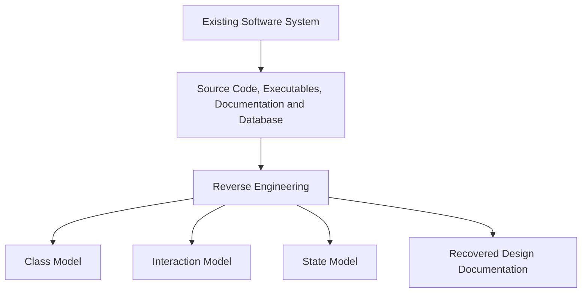

### 5. Conclusion
Reverse Engineering analyses an existing software system to recover its design and internal structure. Its inputs include source code, executables, documentation and database structures; outputs include class, interaction and state models and recovered design documentation. It supports understanding, maintaining and improving legacy systems.

---

## Q17. Write short notes on: (i) Wrapping (ii) Maintenance.

**Marks: 7 | Difficulty: Low**

### (i) Wrapping

**Definition:** **Wrapping** is a technique used in legacy systems to provide a new interface to existing software components without modifying their internal implementation. It allows old components to communicate with modern applications through a wrapper.

**Steps Involved:**

1. **Identify Legacy Components:** Identify existing components that need to be reused.
2. **Understand Functionality:** Study their interfaces, operations and limitations.
3. **Create Wrapper:** Develop a new interface around the legacy component.
4. **Convert Data:** Convert inputs and outputs into formats compatible with the new system.
5. **Integrate Components:** Connect the wrapper with modern applications.
6. **Test the Wrapper:** Verify communication with the existing system.

**Advantages:**
- Reuses existing software components.
- Reduces redevelopment cost.
- Extends the life of legacy systems.
- Supports integration with modern applications.
- Minimizes changes to existing software.

**Example:** A legacy banking application can be wrapped using a REST API so that a modern mobile application can access its services.

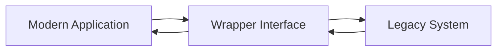

### (ii) Maintenance

**Definition:** **Software Maintenance** is the process of modifying and updating existing software after delivery to correct errors, improve performance and adapt to changing requirements. It ensures that software continues to operate effectively throughout its lifetime.

**Types of Software Maintenance:**

1. **Corrective Maintenance:** Fixes errors and defects discovered after delivery. Example: Correcting an incorrect banking transaction calculation.
2. **Adaptive Maintenance:** Modifies software to work in a changed environment. Example: Updating software to support a new operating system.
3. **Perfective Maintenance:** Improves existing functionality, performance and usability. Example: Adding new features to an existing application.
4. **Preventive Maintenance:** Modifies software to prevent future problems and improve maintainability. Example: Refactoring code to reduce complexity.

**Importance:**
- Improves software reliability.
- Corrects errors and defects.
- Supports changing user requirements.
- Enhances performance and security.
- Extends the software's useful life.

### 4. Conclusion
Wrapping provides a new interface to existing legacy software without changing its internal implementation, whereas Maintenance modifies existing software to correct errors and improve functionality. Both help extend the life and usefulness of legacy systems.
